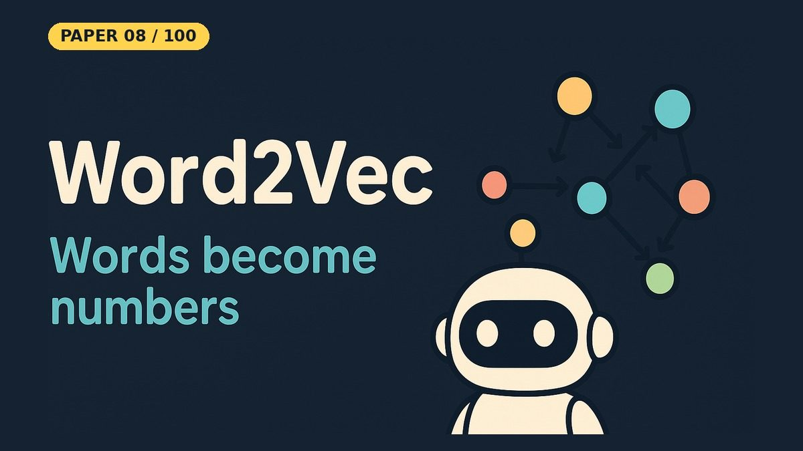

# Word2Vec — Efficient Estimation of Word Representations in Vector Space

- **Paper:** [Efficient Estimation of Word Representations in Vector Space](https://arxiv.org/abs/1301.3781)
- **Authors:** Tomas Mikolov, Kai Chen, Greg Corrado, Jeffrey Dean
- **Lab, year:** Google, 2013
- **Video:** YouTube Short coming on 23 Oct 2026 on [Backprop Daily](https://www.youtube.com/@BackpropDaily)

## Summary

Before Word2Vec, NLP systems treated words as atomic units — discrete indices in a vocabulary with no notion of similarity. "King" and "queen" were as different as "king" and "toaster." Neural language models existed but were too slow to train on billion-word datasets. Mikolov et al. proposed two lightweight architectures — **Continuous Bag-of-Words (CBOW)** and **Skip-gram** — that learn dense vector representations of words from raw text at unprecedented scale and speed. On a single machine, high-quality vectors could be trained from 1.6 billion words in under a day.

## What Problem Does It Solve

Imagine you have a huge box of Lego pieces, and each piece is a word. If the pieces are all random shapes, you can't tell that "king" and "queen" are more related than "king" and "toaster." Before this paper, computers treated every word like a totally random Lego piece — just an ID number with no sense of which words are similar or different.

Word2Vec solves this by turning each word into a list of numbers (a vector) so that words with similar meanings end up close together on a map. Think of it like arranging books on a shelf: books about cooking go together, books about space go together, and "king" and "queen" sit right next to each other while "king" and "toaster" are far apart. Even better, the directions between words carry meaning — the distance and direction from "king" to "queen" is the same as from "man" to "woman," because the vector learned that "king − man + woman ≈ queen." This let computers, for the first time, understand that words aren't just labels — they have relationships, and those relationships can be measured with math.

## Core Idea

Strip the neural network language model down to almost nothing. No hidden layers, no nonlinearities, no complex preprocessing. Just a lookup table (embedding matrix) and a softmax classifier. **Skip-gram** predicts context words from a center word; **CBOW** predicts a center word from its context. By removing the hidden layer entirely, training becomes so cheap that you can throw billions of words at it and still finish in hours on a commodity machine. The resulting vectors capture semantic and syntactic relationships — most famously, vector arithmetic reveals analogies like `king − man + woman ≈ queen`.

## Key Method Details

### Skip-gram Architecture
- **Input:** A center word (one-hot vector of dimension V = vocab size).
- **Embedding:** Multiply one-hot by the input embedding matrix W (V×d) to get the word's d-dimensional vector.
- **Output:** Predict each context word within a window of size C using a softmax over the vocabulary: `p(w_c \| w_t) = exp(v'_{w_c}^T v_{w_t}) / Σ exp(v'_w^T v_{w_t})`
- **Two matrices:** Input embeddings W and output embeddings W'. The final word vectors are typically W (the input embeddings).

### CBOW Architecture
- Reverse of Skip-gram: average the embeddings of context words, then predict the center word.

### Negative Sampling (from the follow-up paper, arXiv:1310.4546)
- Full softmax over the entire vocabulary is expensive (O(V) per training step).
- **Negative sampling** replaces the softmax with a binary classification task: for each (center, context) pair, sample k random "negative" words from a noise distribution (unigram^0.75). The loss becomes:
  `L = −log σ(v'_{w_c}^T v_{w_t}) − Σ_{k} log σ(−v'_{w_n}^T v_{w_t})`
- This reduces computation from O(V) to O(k+1) per step, enabling training on massive corpora.

### Training Setup (from the paper)
- Google News corpus of about 6 billion tokens, vocabulary limited to the 1 million most frequent words (Section 4.2)
- Embedding dimensions: tested 50–1000
- Training time: the abstract reports high-quality vectors from 1.6 billion words in less than a day
- Evaluation: word similarity tasks and analogy tasks (semantic + syntactic)

### Simplifications in This Notebook

- Skip-gram with **negative sampling** (from the follow-up paper, arXiv:1310.4546) instead of the hierarchical softmax used in this paper
- A tiny hand-written corpus: 14 sentences, 26 words in the vocabulary, 112 tokens after filtering
- 50-dimensional vectors, 80 epochs, learning rate 0.03, k = 5 negative samples, plain NumPy

### What the Notebook Result Shows

The training loss fell from **4.1584** (epoch 1) to **2.3532** (epoch 80), so the model did learn something. But with only 112 tokens, the vectors are not good. The nearest neighbours of "king" are mostly common words ("to" 0.798, "war" 0.791, "ruled" 0.782), and the analogies fail: king − queen + prince gives "to" first ("princess" is third), and princess − prince + queen gives "with" instead of "king". Only "knight" and "dragon" end up as each other's closest word (0.888). The paper's analogy results need millions to billions of words.

## Influence

Word2Vec was a watershed moment for NLP. It demonstrated that meaningful semantic representations could be learned from raw text at scale, without labels. The word analogy discovery (`king − man + woman = queen`) became one of the most iconic results in machine learning, proving that vector spaces encode structured relationships. Word2Vec embeddings became the default input representation for NLP tasks (sentiment analysis, machine translation, named entity recognition) for years, until contextual embeddings (ELMo, BERT) superseded them. The Skip-gram + negative sampling recipe also directly inspired embedding methods in other domains — node2vec for graphs, item2vec for recommendations, and more.

- **GloVe** (Pennington et al., 2014) — an alternative based on global co-occurrence matrices
- **FastText** (Mikolov et al., 2016) — extends Word2Vec to subword units
- **ELMo / BERT** — contextual embeddings that replaced static Word2Vec vectors
- **Item2Vec, node2vec, doc2vec** — the "2vec" pattern spread across domains
- The concept of learning dense representations from self-supervised objectives became foundational to modern deep learning

---

## Resources

| File | Description |
|------|-------------|
| [README.md](README.md) | This overview — a 5-minute read covering the paper's summary, core idea, key method details, influence, and a plain-English explanation of the problem it solves |
| [solution.ipynb](https://nbviewer.org/github/nadeemcite/research-papers/blob/main/001_word2vec-efficient-estimation-of-word/solution.ipynb) | Complete from-scratch PyTorch implementation of the paper's architecture, with training loops, visualizations, and worked examples |
| [CODE_ARCHITECTURE.md](CODE_ARCHITECTURE.md) | Section-by-section breakdown of the notebook — what each cell does, data flow, tensor shapes, and key design decisions |
| [TALK.md](TALK.md) | Press coverage, blog posts, Q&A (answers from the paper), citations, and common misconceptions about the paper |
