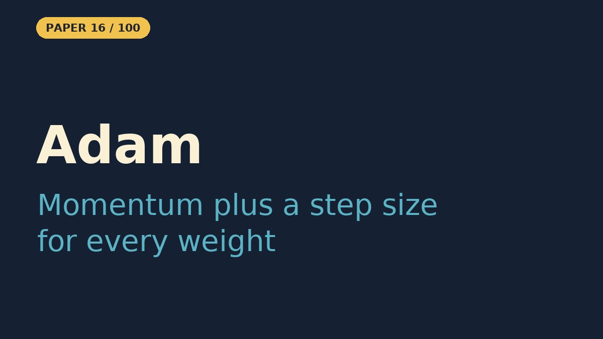

# Adam — A Method for Stochastic Optimization

- **Paper:** [Adam: A Method for Stochastic Optimization](https://arxiv.org/abs/1412.6980)
- **Authors:** Diederik P. Kingma, Jimmy Ba
- **Lab, year:** University of Amsterdam & University of Toronto, 2014
- **Video:** [Watch the YouTube Short](https://youtube.com/shorts/u73WBo61HhM) on [Backprop Daily](https://www.youtube.com/@BackpropDaily)

## Summary

Adam is an optimizer: the rule that decides how a neural network's weights change after each batch of training data. It only needs first-order gradients (the slope of the loss), and it is built for *stochastic* objectives, where each batch gives a noisy estimate of that slope.

It combines two earlier ideas. **Momentum** smooths the direction of each step with a running average of past gradients. **Per-parameter adaptive step sizes**, as in AdaGrad and RMSProp, divide each update by a running estimate of how large that parameter's gradients usually are.

Adam keeps moving averages of the gradient (the first moment) and of the squared gradient (the second moment). It corrects both for their bias toward zero at the start, then steps by their ratio. Each step is then roughly no larger than the learning rate, does not change if the gradient is rescaled, and needs little tuning.

The paper also proves a regret bound (a guarantee on total error) in the online convex setting and introduces **AdaMax**, a variant based on the infinity norm. In its experiments, Adam matches or beats SGD with momentum, AdaGrad and RMSProp on logistic regression, multilayer networks and CNNs. It went on to become the default optimizer for most of deep learning.

## What Problem Does It Solve

Imagine you're blindfolded on a hilly trail and trying to find the lowest point in a valley. You feel the ground with your feet and take a step downhill. That's how neural networks learn — they feel the "slope" (gradient) and take a step. But the problem is: some parts of the hill are super steep and some are nearly flat. If you take the same-sized step everywhere, you'll overshoot on the steep parts and crawl on the flat parts. You need a smart way to take big steps on flat ground and tiny careful steps on steep ground.

Adam solves this by giving each parameter its own personal step size that automatically adjusts. It's like hiking with a smart pedometer that remembers two things: which direction you've been heading (momentum) and how bumpy the ground has been (step size scaling). If the ground is consistently sloping one way, Adam takes confident steps. If the ground is bouncing up and down, Adam takes tiny careful steps so it doesn't fall over. And it has a special trick to avoid being too cautious at the very start when it hasn't seen enough of the trail yet. This made Adam the go-to "engine" for training almost every modern AI model.

## Core Idea

Adam computes a **running estimate of the first moment** (mean gradient, i.e. momentum) and a **running estimate of the second moment** (mean squared gradient, i.e. per-parameter scale) of the gradient. It then divides the momentum step by the square root of the second moment, so parameters that historically bounce around get tiny steps and parameters with a consistent direction get larger steps. The clever twist is a **bias-correction term** in the first few iterations: because the moving averages are initialized at zero, early estimates are biased toward zero; Adam divides them by a correction factor that quickly converges to 1.

## Key Method Details

The algorithm, for parameter vector `θ`, gradient `g_t`, and step `t`:

1. Compute gradient: `g_t = ∇f_t(θ_{t-1})`
2. Update biased first-moment estimate: `m_t = β1 · m_{t-1} + (1 − β1) · g_t`
3. Update biased second-moment estimate: `v_t = β2 · v_{t-1} + (1 − β2) · g_t²`  (elementwise)
4. Bias-correct:
   - `m̂_t = m_t / (1 − β1^t)`
   - `v̂_t = v_t / (1 − β2^t)`
5. Update parameters: `θ_t = θ_{t-1} − α · m̂_t / (√v̂_t + ε)`

Recommended defaults: `α = 0.001`, `β1 = 0.9`, `β2 = 0.999`, `ε = 10⁻⁸`.

Adam is invariant to diagonal rescaling of the gradients, works with sparse gradients, non-stationary objectives, and naturally anneals step sizes as `v_t` accumulates history.

### What the Notebook Result Shows

The notebook implements SGD, RMSProp and Adam from scratch in NumPy and runs each for 200 steps from the point (−2, 2) on a noise-free 2-D valley, `L(x, y) = (x − 1)² + 5(y − 0.5x)²`, whose minimum is at (1, 0.5). On this toy, **tuned plain SGD wins and Adam finishes last**:

| Optimizer | Learning rate | Final loss after 200 steps | End point |
|---|---|---|---|
| SGD | 0.02 | 9.1e-6 | (0.997, 0.498) |
| RMSProp | 0.05 | 6.7e-3 | (1.023, 0.477) |
| Adam | 0.05 | 3.7e-2 | (0.813, 0.385) |

SGD has an exact gradient and a learning rate that suits this bowl, so it slides straight to the minimum. RMSProp and Adam take steps of roughly the learning rate in size, so RMSProp keeps bouncing near the minimum, and Adam's momentum makes it overshoot and curve along the valley (visible in the contour plot and animation).

This is not evidence against Adam. The paper's case for Adam is about noisy, stochastic gradients, sparse features and many parameters with very different scales; a two-parameter problem with exact gradients is the setting where one well-chosen learning rate is enough.

## Influence

Adam became the default optimizer for a huge swath of deep learning — transformers, GANs, variational autoencoders, recommendation models — because it usually trains fast with little hyperparameter tuning. It also inspired later variants such as **AdamW** (which fixes weight-decay interaction) and **AMSGrad**. The Adam family, most often AdamW, remains the default optimizer for training large neural networks.

---

## Resources

| File | Description |
|------|-------------|
| [README.md](README.md) | This overview — a 5-minute read covering the paper's summary, core idea, key method details, influence, and a plain-English explanation of the problem it solves |
| [solution.ipynb](https://nbviewer.org/github/nadeemcite/research-papers/blob/main/003_adam-a-method-for-stochastic/solution.ipynb) | From-scratch NumPy implementation of SGD, RMSProp and Adam on a 2-D toy loss, with a contour plot of the trajectories and an animated GIF of Adam's path |
| [CODE_ARCHITECTURE.md](CODE_ARCHITECTURE.md) | Section-by-section breakdown of the notebook — what each cell does, data flow, tensor shapes, and key design decisions |
| [TALK.md](TALK.md) | Press coverage, blog posts, Q&A (answers from the paper), citations, and common misconceptions about the paper |
