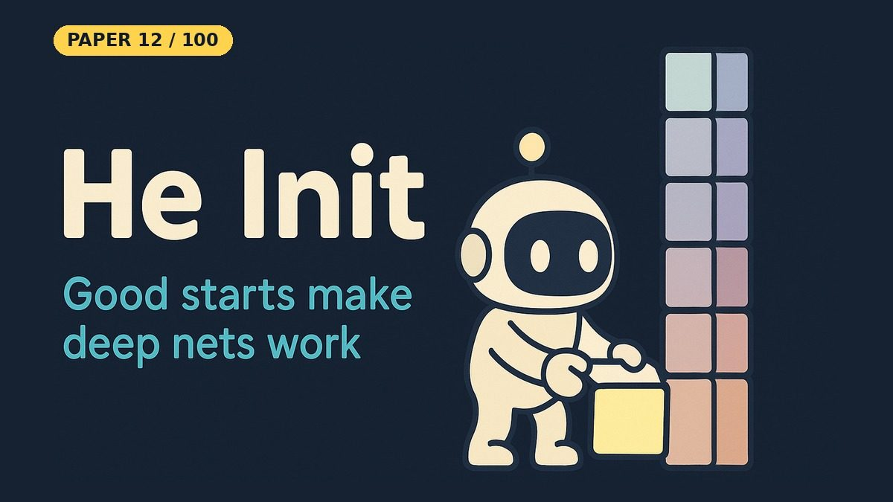

# Delving Deep into Rectifiers: Surpassing Human-Level Performance on ImageNet Classification

- **Paper:** [Delving Deep into Rectifiers: Surpassing Human-Level Performance on ImageNet Classification](https://arxiv.org/abs/1502.01852)
- **Authors:** Kaiming He, Xiangyu Zhang, Shaoqing Ren, Jian Sun
- **Lab, year:** Microsoft Research, 2015
- **Video:** [Watch the YouTube Short](https://youtube.com/shorts/p2LGxyhIRKw) on [Backprop Daily](https://www.youtube.com/@BackpropDaily)

## Summary

This paper introduced two practical advances that made very deep rectifier networks trainable at scale. First, the authors proposed **Parametric ReLU (PReLU)**, a generalization of ReLU in which the slope of the negative half is no longer fixed at 0 (or 0.01 for Leaky ReLU) but is learned jointly with the rest of the model. PReLU adds only one extra parameter per channel and improves model fitting with almost no extra compute.

Second, the paper derived **He initialization**, a theoretically grounded weight initialization that accounts for the fact that ReLU zeros-out half of its inputs. Instead of the Xavier/Glorot rule `Var(W)=1/fan_in`, He initialization uses `Var(W)=2/fan_in` for ReLU, so the variance of activations stays roughly constant across many layers.

When combined with SPP-net-style architectures, PReLU-nets reached **4.94% top-5 error on ImageNet 2012**, the first result reported to surpass human-level performance on that benchmark.

## What Problem Does It Solve

Imagine you are whispering a message through a very long line of people — each person can only pass on what they hear. If every person mumbles a little more quietly than the person before, by the time the message reaches the end it is so faint that nobody can hear it. That is what happens in a deep neural network when the weights are initialized too small: the signal **vanishes** before it reaches the output. If every person shouts a little louder than the one before, the message becomes deafening noise by the end. That is what happens when weights are initialized too large: the signal **explodes**.

Deep networks with ReLU activations were especially tricky because ReLU literally cuts off the negative half of each signal, which changes the average strength of the message at every layer. He et al. figured out exactly how loud each person should speak so the message stays the same volume all the way down the line. They also gave each person a small knob (PReLU) to decide how much of the "negative" part of the message to keep, instead of throwing it away by default. The result is that very deep networks can be trained from scratch without the signal dying or blowing up.

## Core Idea

- **Learn the negative slope:** PReLU makes the slope of a rectifier's negative half a learnable parameter (per channel, or shared per layer). It generalizes ReLU and Leaky ReLU at almost no extra cost.
- **Initialize for rectifiers, not linear units:** derive the weight scale from how signal variance flows through ReLU/PReLU layers. This gives a zero-mean Gaussian with standard deviation `sqrt(2/fan_in)`, so activations and gradients neither vanish nor explode as depth grows.
- **Train very deep rectifier networks from scratch:** together, the two ideas make much deeper models trainable directly, and PReLU networks were the first reported to surpass human-level top-5 accuracy on ImageNet 2012.

## Key Method Details

* **PReLU** is defined as `f(y_i) = max(0, y_i) + a_i * min(0, y_i)`. When `a_i=0` it reduces to ReLU; when `a_i` is learned it becomes PReLU. A channel-shared variant uses a single `a` per layer. PReLU is initialized at `a=0.25` and trained with plain SGD + momentum (no weight decay on `a`).
* **He initialization** is derived by requiring that the variance of a layer's output equals the variance of its input. For ReLU, because `E[x^2] = 1/2 Var[y]` after the rectifier, the variance recursion becomes `Var[y^L] = Var[y^1] * prod_l (1/2 * n_l * Var[w_l])`. Setting each factor to 1 gives `Var[w_l] = 2 / n_l`, i.e. a zero-mean Gaussian with standard deviation `sqrt(2/fan_in)`. For PReLU the factor generalizes to `2 / ((1 + a^2) * fan_in)`.
* The derivation is given for both forward propagation and back-propagation, showing that keeping either the forward signal or the backward gradient stable is sufficient for the other to remain stable as well.
* The authors trained extremely deep models (up to 30 weight layers) directly from scratch, whereas prior work either stalled or needed layer-wise pre-training with Xavier-style initialization.

### Simplifications in This Notebook

- A plain **NumPy MLP** (64 units per layer) on the 2-D **make_moons** toy dataset (1,600 train and 400 test points), instead of large CNNs on ImageNet
- Plain mini-batch SGD (learning rate 0.05, batch size 64); He init `std = sqrt(2/fan_in)` vs the "Xavier" rule `std = sqrt(1/fan_in)` used in the paper's comparison
- PReLU is only tried once, in a short extra cell

### What the Notebook Result Shows

On this easy task, both initializations train. With 10 layers and 100 epochs, He and Xavier both reached **97.25%** test accuracy. In the shorter 30-epoch stress test, He reached 97.25% at both 10 and 20 layers, while Xavier reached 95.25% (10 layers) and 95.50% (20 layers). The 10-layer PReLU network with He-style init reached 96.5% after 80 epochs.

So He init was a bit better in the short runs, but Xavier did **not** stall here. The paper's big difference (Xavier completely stalls on a 30-layer model) needs much deeper networks than this toy run.

## Influence

The He initialization rule became the de-facto default for ReLU networks in PyTorch (`torch.nn.init.kaiming_normal_`) and TensorFlow/Keras (`he_normal`). PReLU, an early learned activation function, is part of the line of work on improved rectifier alternatives that later produced activations such as ELU, GELU, and Swish, and the paper's analysis remains a standard reference for why deep networks need careful weight scaling.

---

## Resources

| File | Description |
|------|-------------|
| [README.md](README.md) | This overview — a 5-minute read covering the paper's summary, core idea, key method details, influence, and a plain-English explanation of the problem it solves |
| [solution.ipynb](https://nbviewer.org/github/nadeemcite/research-papers/blob/main/007_delving-deep-into-rectifiers/solution.ipynb) | Complete from-scratch NumPy implementation of the paper's architecture, with training loops, visualizations, and worked examples |
| [CODE_ARCHITECTURE.md](CODE_ARCHITECTURE.md) | Section-by-section breakdown of the notebook — what each cell does, data flow, tensor shapes, and key design decisions |
| [TALK.md](TALK.md) | Press coverage, blog posts, Q&A (answers from the paper), citations, and common misconceptions about the paper |
