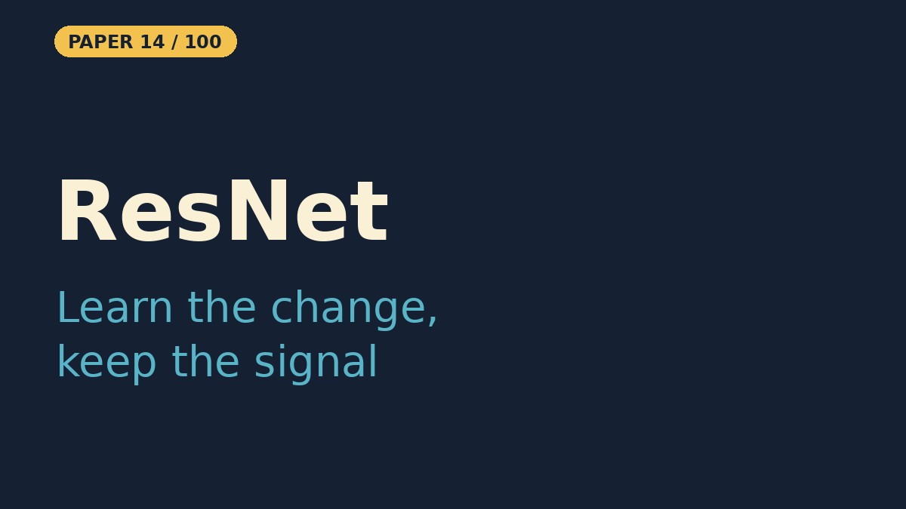

# ResNet — Deep Residual Learning for Image Recognition

- **Paper:** [Deep Residual Learning for Image Recognition](https://arxiv.org/abs/1512.03385)
- **Authors:** Kaiming He, Xiangyu Zhang, Shaoqing Ren, Jian Sun
- **Lab, year:** Microsoft Research, 2015
- **Video:** YouTube Short coming on 29 Oct 2026 on [Backprop Daily](https://www.youtube.com/@BackpropDaily)

## Summary

Residual networks (ResNets) introduced a simple but powerful idea: instead of asking a stack of layers to learn a direct mapping `H(x)`, train them to learn the *residual* mapping `F(x) = H(x) - x` and add the input `x` back with a shortcut (skip) connection. By reformulating deep layers as residual functions, the paper showed that networks with hundreds or even thousands of layers can be optimized reliably, whereas plain (stacked) networks suffer from degradation—accuracy saturates and then drops as depth increases, even when overfitting is not the cause.

The key method is the **residual block**. For an input `x`, a block with weight layers computes `F(x) + x`. When the dimensions of `F(x)` and `x` differ, a linear projection by `1×1` convolutions matches them. A deeper architecture is built by stacking these blocks, and experiments on ImageNet demonstrate that ResNets scale gracefully from 34 layers to 152 layers, winning the ILSVRC 2015 classification competition with a 3.57% top-5 test error. The same principle also produced 100+ layer networks that train well on CIFAR-10.

ResNet’s influence is enormous: it replaced VGG-style plain stacks as the default backbone (the base network that turns an image into features that other vision models build on) for vision, enabled much deeper architectures (ResNeXt, DenseNet, EfficientNet, transformers), and the skip-connection idea is now used in nearly every modern network, including attention models and diffusion backbones.

## What Problem Does It Solve

Imagine you are trying to send a message across a very long chain of whispering friends. With every extra friend, the message gets a little more garbled. Adding more friends does not help—it actually makes the final message worse, even though each friend is trying hard. ResNet solves the "long chain" problem for deep neural networks.

In a normal deep network, every new layer has to rewrite the entire signal from scratch. As the network gets deeper, this becomes harder and harder, so accuracy stops improving and even drops. ResNet gives each layer an *express lane*—a shortcut that carries the original signal forward. A layer only has to learn the small change (the "residual") it wants to make to that signal. If a layer is not useful, it can simply let the signal pass through. Because the original information is never lost, the network can become much deeper without getting confused, much like letting every friend both whisper a small correction and pass the original message on unchanged.

## Core Idea

- **Learn the residual:** instead of fitting the desired mapping `H(x)` directly, a block fits `F(x) = H(x) - x` and outputs `F(x) + x`.
- **Identity shortcut:** the skip connection adds no parameters (when shapes match) and gives gradients a direct path back through the network.
- **Fixes degradation:** with shortcuts, a deeper network can do at least as well as a shallower one, because extra layers can learn `F(x) ≈ 0` and pass the signal through.

## Key Method Details

- **Block:** two `3×3` convolutions with batch normalization and ReLU, plus the shortcut: `y = relu(F(x) + x)`.
- **Shape changes:** when the stride or channel count changes, the shortcut is a `1×1` convolution (a projection) so the two branches can be added.
- **Depth:** 18, 34, 50, 101 and 152 layers on ImageNet (the deeper ones use three-layer bottleneck blocks). The paper also trains CIFAR-10 networks of 20 to 110 layers and one with 1202 layers.
- **Result:** an ensemble of residual networks won ILSVRC 2015 classification with 3.57% top-5 test error.

### What the Notebook Result Shows

The notebook trains an 18-layer-style PlainNet and ResNet (about 11M parameters each) on CIFAR-10 for 25 epochs with SGD, learning rate 0.1, momentum 0.9, weight decay 5e-4, a step schedule, and random-crop plus flip augmentation. They finish within a point of each other: PlainNet **91.37%** and ResNet **90.70%** test accuracy (one unseeded run each, so a gap that small is noise). At 18 layers with batch normalization there is no degradation to fix, so this toy does not reproduce the paper's gap; the paper's comparison uses deeper plain networks (20 vs 56 layers on CIFAR-10).

#### Why they tie here (and why ResNet still matters)

Think of stacking blocks into a tower. A short tower of 18 blocks stands fine with or without glue. Stack it to 34 or 56 blocks without glue and it starts to wobble, while a glued tower keeps standing. The shortcut in ResNet is the glue. Its win is not "a higher score at the same height". Its win is "you can build taller without the tower falling over."

Our notebook is the short tower. At 18 layers with batch normalization the plain net trains fine, so both land in the same place. The paper says the same thing: its 18-layer plain and residual nets are comparably accurate, and the ResNet only converges faster. The gap shows up when depth grows:

| ImageNet top-1 error (10-crop, validation) | Plain | ResNet |
|---|---|---|
| 18 layers | 27.94% | 27.88% |
| 34 layers | 28.54% (worse than 18) | 25.03% (better than 18) |

On CIFAR-10 the same pattern appears: plain-56 has higher training and test error than plain-20 (Figure 1), while a 110-layer ResNet reaches 6.43% test error (best run).

**Takeaway:** a tie at 18 layers is expected; ResNet pays off when you go deeper.

## Influence

ResNet became the default backbone for vision and the template for deep architectures that followed (ResNeXt, DenseNet, EfficientNet). The identity skip connection is now in almost every deep model, including Transformers and diffusion U-Nets.

---

## Resources

| File | Description |
|------|-------------|
| [README.md](README.md) | This overview — a 5-minute read covering the paper's summary, core idea, key method details, influence, and a plain-English explanation of the problem it solves |
| [solution.ipynb](https://nbviewer.org/github/nadeemcite/research-papers/blob/main/008_resnet-deep-residual-learning-for-image/solution.ipynb) | Complete from-scratch PyTorch implementation of the paper's architecture, with training loops, visualizations, and worked examples |
| [CODE_ARCHITECTURE.md](CODE_ARCHITECTURE.md) | Section-by-section breakdown of the notebook — what each cell does, data flow, tensor shapes, and key design decisions |
| [TALK.md](TALK.md) | Press coverage, blog posts, Q&A (answers from the paper), citations, and common misconceptions about the paper |
