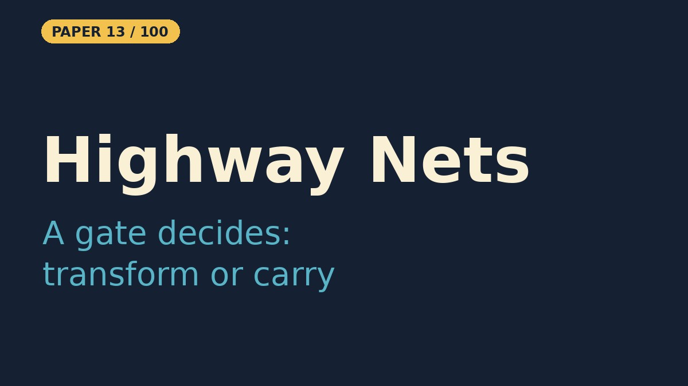

# Highway Networks

- **Paper:** [Highway Networks](https://arxiv.org/abs/1505.00387) (full version: [Training Very Deep Networks](https://arxiv.org/abs/1507.06228))
- **Authors:** Rupesh Kumar Srivastava, Klaus Greff, Jürgen Schmidhuber
- **Lab, year:** IDSIA, 2015
- **Video:** YouTube Short coming on 28 Oct 2026 on [Backprop Daily](https://www.youtube.com/@BackpropDaily)

## Summary

Highway networks were among the first practical demonstrations that feed-forward neural networks with hundreds of layers could be trained end-to-end with ordinary SGD. The key idea is to let each layer learn a smooth, data-dependent blend between transforming its input and simply carrying it forward. For every block, two functions are computed: a *block state* `H(x)` (a normal non-linear transformation) and a *transform gate* `T(x) = σ(W_T x + b_T)`. The layer then outputs `y = H(x)·T(x) + x·(1 − T(x))`. Because the transform gate is bounded in `[0, 1]`, the layer can act like a plain layer when `T ≈ 1`, act like an identity ("highway") when `T ≈ 0`, or interpolate anywhere in between. This gating mechanism is borrowed from LSTM memory cells, and the crucial initialization trick is to set the transform-gate bias to a negative value (e.g. −2 or −4) so the network starts by passing information forward almost unchanged. The authors showed that highway networks of up to 100 layers optimized well on MNIST, while plain networks got harder to train as depth grew. In Section 3.1 they also report that a 900-layer highway network had started training with no optimization difficulty so far; that run was preliminary. Highway networks are a direct precursor to ResNet: ResNet's `y = F(x) + x` is like a highway block whose carry path is always open, with no gate.

## What problem does it solve

Imagine you are trying to pass a whispered message around a classroom by having every student whisper it to the next. With only two or three students the message usually arrives intact, but with twenty students the message becomes a garbled mess. That garbling is exactly what happens to gradients and useful signals when you stack dozens of plain neural-network layers: the signal gets distorted or squeezed away, and the network becomes very hard to train.

Highway Networks solve this by giving the classroom an intercom system. Now each student can choose either to repeat the message unchanged (carry it forward on the highway) or to add their own small summary (transform it). At first every student is told to just repeat the message, so nothing gets lost. As training progresses, some students learn when it is safe to add useful details, and others keep passing the original message through. The result is that you can have many, many "students" (layers) in the chain without the message dying, and the network can be trained with ordinary methods.

## Core Idea

- **Gated skip connection:** each layer computes `y = H(x)·T(x) + x·(1 − T(x))`, so it can transform its input, copy it, or mix the two.
- **Carry-first initialization:** the transform-gate bias starts at a negative value, so every layer begins close to the identity and the signal reaches the output at the start of training.
- **Depth without special tricks:** with the gates in place, very deep plain-SGD training works without layer-wise pre-training or hand-tuned initialization.

## Key Method Details

- **Layer:** `H(x) = act(W_H x + b_H)` and `T(x) = σ(W_T x + b_T)`. The carry gate is tied to the transform gate as `C = 1 − T`.
- **Gate bias:** `b_T` is initialized to a negative constant (the paper uses values such as −2 to −4). More negative values start the network closer to the identity.
- **Cost:** each layer has two weight matrices instead of one, so a highway layer has about twice the parameters of a plain layer of the same width. The paper compares against plain networks of matched parameter count by adjusting the widths.
- **Depth:** the paper's experiments go up to 100 layers, with a preliminary 900-layer run. The full version also reports CIFAR experiments.

## Influence

Highway networks showed that depth is an optimization problem that gating a skip path can solve, and they arrived months before ResNet. ResNet drops the gate and keeps an always-open identity path, which is simpler and cheaper, and it became the standard. The gating idea lives on in LSTM-style and GRU-style cells, in gated convolutions, and in the gated feed-forward layers of many modern Transformers.

## Notebook results

The notebook trains a 20-layer Highway MLP and a plain 20-layer MLP on MNIST (hidden width 64, 10 epochs, Adam with learning rate 1e-3, gate bias −2). The Highway network reaches **97.2%** validation accuracy against **95.6%** for the plain network, and it is already at 94.3% after the first epoch while the plain network starts near chance (11.4%) and catches up over the following epochs. The plain network is not parameter-matched, so treat this as an illustration of the effect, not a controlled comparison.

---

## Resources

| File | Description |
|------|-------------|
| [README.md](README.md) | This overview — a 5-minute read covering the paper's summary, core idea, key method details, influence, and a plain-English explanation of the problem it solves |
| [solution.ipynb](https://nbviewer.org/github/nadeemcite/research-papers/blob/main/009_highway-networks/solution.ipynb) | Complete from-scratch PyTorch implementation of the paper's architecture, with training loops, visualizations, and worked examples |
| [CODE_ARCHITECTURE.md](CODE_ARCHITECTURE.md) | Section-by-section breakdown of the notebook — what each cell does, data flow, tensor shapes, and key design decisions |
| [TALK.md](TALK.md) | Press coverage, blog posts, interview Q&A, citations, and common misconceptions about the paper |
