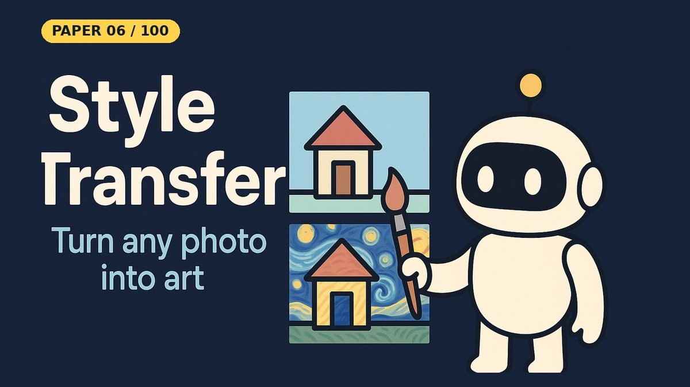

# A Neural Algorithm of Artistic Style

- **Paper:** [A Neural Algorithm of Artistic Style](https://arxiv.org/abs/1508.06576)
- **Authors:** Leon A. Gatys, Alexander S. Ecker, Matthias Bethge
- **Lab, year:** University of Tübingen, Bernstein Center, MPI for Biological Cybernetics, 2015 (CVPR 2016 version: *Image Style Transfer Using Convolutional Neural Networks*)
- **Video:** YouTube Short coming on 21 Oct 2026 on [Backprop Daily](https://www.youtube.com/@BackpropDaily)

## Summary

The paper proposes a way to turn a photograph into a painting in the style of another image using a pretrained deep convolutional network. The key observation is that the layers of a CNN trained on object recognition encode *content* and *style* in separable ways. Higher convolutional layers capture objects and their spatial layout (content), while the correlations between filter responses—summarised by a Gram matrix—capture texture, colour, and local brush-stroke patterns (style). Gatys et al. showed that a new image can be synthesised by optimising random pixels so that its VGG-19 features match the content features of one image at `conv4_2` and the style Gram matrices of another image at multiple layers (`conv1_1` through `conv5_1`). The synthesis uses only the convolutional part of VGG-19 with average pooling, freezes the network weights, and treats the pixel values of the generated image as the only trainable parameters. This work established the field of neural style transfer, inspired mobile apps such as Prisma and DeepArt, and remains the reference implementation for optimisation-based style transfer.

## What Problem Does It Solve

Imagine you have a favourite family photograph and you wish it looked like it was painted by Vincent van Gogh. Before this paper, you would need a human artist to redraw the photo in that style, because computers could not reliably separate *what* is in a picture from *how* it looks.

The paper solves this separation problem by borrowing the brain-like processing of a deep convolutional network. Think of the network as a stack of filters that first see edges and colours, then textures, then objects. The researchers discovered that one particular layer keeps a good sketch of the objects and their positions (the content), while the correlations between filters at several layers capture the painting’s texture, colours, and small strokes (the style). They then create a brand-new image whose pixels are gradually adjusted until it satisfies both demands at once: "look like this photo in terms of things and where they are, and look like that painting in terms of colours and brushwork." The result is a computer-generated artwork that keeps your family photo but feels as if Van Gogh had painted it.

## Core Idea

- **Content and style are separable inside a CNN:** in a network trained for object recognition (VGG-19), the feature maps of higher layers describe *what* is in an image and where, while the correlations between feature maps (Gram matrices) across several layers describe *how* it looks: texture, colour and brush strokes.
- **Synthesize by optimization, not training:** the network weights stay frozen; only the pixels of a new image are optimized so that it matches the content representation of a photo and the style representation of an artwork.
- **One knob for the trade-off:** the total loss is a weighted sum of a content loss and a style loss, and the ratio α/β controls whether the result looks more like the photo or more like the painting.

## Key Method Details

- Base network: VGG-19 pretrained on ImageNet; only 16 convolutional + 5 pooling layers are used; fully connected layers are discarded.
- Content representation: feature maps `F^l` of the generated image `x` at layer `l` are compared to the corresponding maps `P^l` of the content image `p` with `L_content(p,x,l) = (1/2) Σ (F^l_ij − P^l_ij)^2`. The paper uses `conv4_2` for content.
- Style representation: for each chosen layer, the Gram matrix `G^l = F^l (F^l)^T` is computed; entries measure correlations between different filter responses. The style loss for a layer is the normalised squared distance between Gram matrices: `E_l = (1 / 4 N_l^2 M_l^2) Σ (G^l_ij − A^l_ij)^2`, summed over selected layers with equal weights.
- Total loss: `L_total = α L_content + β L_style`; the ratio `α/β` controls the trade-off (roughly `1e-3` for content-heavy and `1e-4` for style-heavy results).
- Optimisation: start from the content image plus noise and minimise the loss with L-BFGS via back-propagation to the pixels.

## Influence

The paper founded neural style transfer as a research area and was later published at CVPR 2016. It directly inspired follow-ups such as Justin Johnson’s real-time feed-forward style transfer (Perceptual Losses for Real-Time Style Transfer and Super-Resolution, ECCV 2016), fast arbitrary-style methods (AdaIN, Huang & Belongie, ICCV 2017), and commercial products like Prisma and DeepArt. It also contributed to the wider idea of *perceptual loss* and showed that representations learned for object recognition implicitly factor content and appearance, an insight used in image generation, super-resolution, and GAN training ever since.

---

## Resources

| File | Description |
|------|-------------|
| [README.md](README.md) | This overview — a 5-minute read covering the paper's summary, core idea, key method details, influence, and a plain-English explanation of the problem it solves |
| [solution.ipynb](https://nbviewer.org/github/nadeemcite/research-papers/blob/main/010_a-neural-algorithm-of-artistic-style/solution.ipynb) | Complete from-scratch PyTorch implementation of the paper's architecture, with training loops, visualizations, and worked examples |
| [CODE_ARCHITECTURE.md](CODE_ARCHITECTURE.md) | Section-by-section breakdown of the notebook — what each cell does, data flow, tensor shapes, and key design decisions |
| [TALK.md](TALK.md) | Press coverage, blog posts, interview Q&A, citations, and common misconceptions about the paper |
