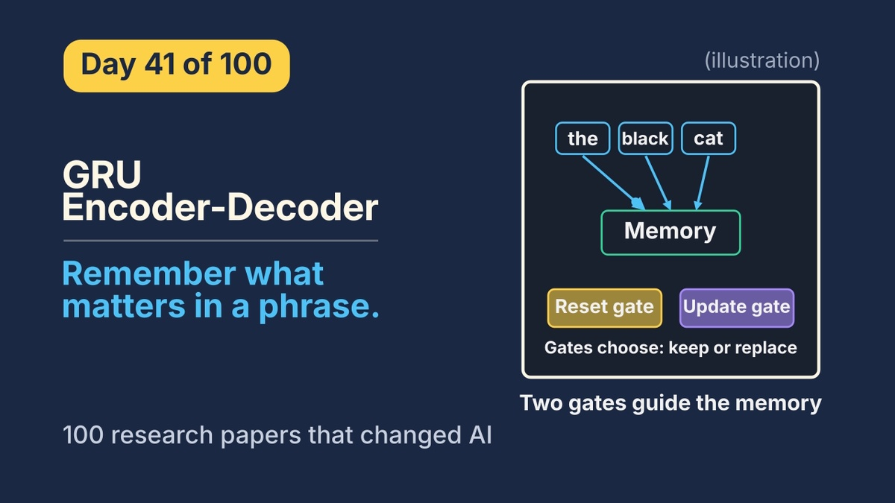

# Learning Phrase Representations using RNN Encoder–Decoder (GRU)

- **Paper:** [Learning Phrase Representations using RNN Encoder–Decoder for Statistical Machine Translation](https://arxiv.org/abs/1406.1078)
- **Authors:** Kyunghyun Cho, Bart van Merriënboer, Caglar Gulcehre, Dzmitry Bahdanau, Fethi Bougares, Holger Schwenk, Yoshua Bengio
- **Lab, year:** Université de Montréal / Jacobs University / Université du Maine (Le Mans), 2014 (EMNLP 2014)
- **Video:** YouTube Short coming on 25 Nov 2026 on [Backprop Daily](https://www.youtube.com/@BackpropDaily)

## Summary

This paper introduced the RNN Encoder–Decoder, built from recurrent neural networks (RNNs, networks that read a sequence one item at a time and keep a running memory): one RNN reads a sentence and squeezes it into a fixed-length vector, and a second RNN turns that vector into another sentence.

To make it work, the authors also proposed a new recurrent hidden unit with two gates, a reset gate and an update gate. It is a simpler cousin of the LSTM and later became known as the GRU (gated recurrent unit).

They used the model to score phrase pairs inside an English→French phrase-based translation system. Adding its score raised BLEU (a standard score of translation quality) on the WMT'14 test set from 33.30 to 33.87, and to 34.64 together with a neural language model.

## What Problem Does It Solve

Imagine reading a long phone number out loud to a friend, who must repeat it only after you finish. A plain recurrent network is like a friend whose memory gets overwritten with every new digit: by the end, the start is gone.

The gated unit gives each memory slot two switches. One (the update gate) decides whether to keep what is stored or overwrite it, and the other (the reset gate) decides whether to ignore the old memory when forming a new one. With these switches, the network can hold on to the important early part of a sequence.

The encoder–decoder idea then uses this memory to read a whole phrase in one language and write it out in another.

## Core Idea

- **Encoder–decoder:** an encoder RNN reads the source sequence into a summary vector c; a decoder RNN generates the target sequence from c, one symbol at a time. Both are trained together to maximize the probability of the target given the source (Section 2.2).
- **Reset gate:** r = σ(W_r x + U_r h_{t−1}); when r is close to 0, the unit ignores the previous hidden state (Section 2.3, Eq. 5).
- **Update gate:** z = σ(W_z x + U_z h_{t−1}) controls how much of the previous state carries over (Eq. 6).
- **New state:** h_t = z ⊙ h_{t−1} + (1 − z) ⊙ h̃, with the candidate h̃ = tanh(W x + U (r ⊙ h_{t−1})) (Eqs. 7–8).

## Key Method Details

- **Model size:** 1,000 gated hidden units in both encoder and decoder, 100-dimensional word embeddings, and a maxout layer before the decoder's output (Section 4.1.1).
- **Training:** Adadelta, 64 phrase pairs per update, about three days, on a phrase table built from 348M words (Section 4.1.1).
- **Use in translation:** the trained model scores each phrase pair in a phrase-based system's table, as an extra feature of its log-linear model (Section 3.1). BLEU on WMT'14 test: 33.30 baseline, 33.87 with the RNN score, 34.64 with a neural language model plus the RNN (Table 1).
- **Representations:** the learned word and phrase representations cluster by meaning and by syntax (Section 4.4).

### Simplifications in This Notebook

The notebook builds the gated unit from scratch with raw `nn.Linear` layers (no `nn.GRU`) and compares it with a plain tanh RNN on a delayed-recall task: the network sees 3 random vectors of 8 numbers, then 5, 10, 20 or 40 blank steps, and must then output the 3 vectors in order. Both networks have 64 hidden units and train with Adam for 300 epochs on 1,000 sequences, with the loss only on the recall steps. There is no encoder–decoder and no translation.

### What the Notebook Result Shows

With 5 blank steps both networks recall the vectors almost perfectly (test MSE **0.0063** for the GRU, **0.0029** for the plain RNN). With 10 and 20 blank steps the GRU still does (**0.0040** and **0.0076**) while the plain RNN largely fails (**0.2557** and **0.6915**, where 1.0 means no recall). With 40 blank steps both fail (about **1.01**), and the gradient reaching the first step shrinks to about 1e-10 (GRU) and 6e-10 (plain RNN).

So the gates extend how long this small network can remember, but not without limit. An earlier version of this notebook used a task that needed no memory, and its claims that the GRU won were not supported by its outputs.

## Influence

OpenAlex lists about 30,700 citations for the EMNLP version ([30,665 when checked on 24 November 2026](https://openalex.org/W2157331557)). The gated unit became known as the GRU; [Chung et al. (2014)](https://arxiv.org/abs/1412.3555) compared it with the LSTM on sequence modeling, and [Bahdanau et al. (2015)](https://arxiv.org/abs/1409.0473) built attention-based translation on the encoder–decoder.

---

## Resources

| File | Description |
|------|-------------|
| [README.md](README.md) | This overview — a 5-minute read covering the paper's summary, core idea, key method details, influence, and a plain-English explanation of the problem it solves |
| [solution.ipynb](https://nbviewer.org/github/nadeemcite/research-papers/blob/main/013_learning-phrase-representations-using-rnn/solution.ipynb) | From-scratch GRU cell vs a plain RNN on a delayed-recall task, with gradient-norm and gate analysis |
| [CODE_ARCHITECTURE.md](CODE_ARCHITECTURE.md) | Section-by-section breakdown of the notebook — what each cell does, data flow, tensor shapes, and key design decisions |
| [TALK.md](TALK.md) | Press coverage, Q&A (answers from the paper), citations, and common misconceptions about the paper |
