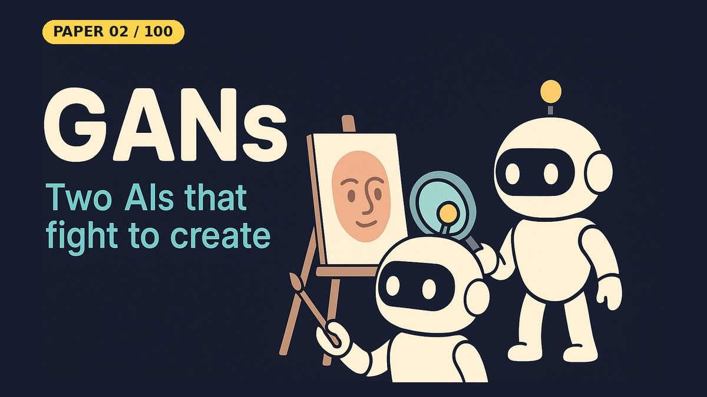

# Generative Adversarial Networks (GAN)

[](https://www.kaggle.com/code/nadymsazad/generative-adversarial-networks-gan)

- **Paper:** [Generative Adversarial Nets](https://arxiv.org/abs/1406.2661)
- **Authors:** Ian Goodfellow, Jean Pouget-Abadie, Mehdi Mirza, Bing Xu, David Warde-Farley, Sherjil Ozair, Aaron Courville, Yoshua Bengio
- **Year:** 2014 (NIPS 2014)
- **Video:** [Watch the YouTube Short](https://youtube.com/shorts/aGXecMt314w) on [Backprop Daily](https://www.youtube.com/@BackpropDaily)

## Summary

Generative Adversarial Networks introduced a radically new framework for training generative models by framing the problem as a two-player game. Instead of defining an explicit likelihood function or relying on Markov chains, GANs pit a **generator network** G (which maps random noise to data-like samples) against a **discriminator network** D (which tries to distinguish real data from generated fakes). The generator's objective is to fool the discriminator; the discriminator's objective is to not be fooled. Through this adversarial process, the generator progressively learns to produce samples that match the true data distribution — all trainable with standard backpropagation, requiring no approximate inference or MCMC sampling. The paper proves that the global optimum of this minimax game is reached when the generator's distribution equals the data distribution and the discriminator outputs 1/2 everywhere (i.e., it cannot distinguish real from fake). The original implementation uses multilayer perceptrons for both G and D, trained on MNIST, the Toronto Face Database (TFD), and CIFAR-10 (where it also tried a convolutional model). The samples were promising but far from photorealistic; sharp images came with later work such as DCGAN. This repo's notebook trains a small MLP GAN on MNIST for 100 epochs. It learns varied, recognizable digits, though many are still rough, as small MLP GANs usually are. With 6,800+ citations and 450+ influential citations (Semantic Scholar), this is one of the most impactful papers in deep learning history, spawning an entire research field including DCGAN, StyleGAN, CycleGAN, Pix2Pix, and eventually contributing to the rise of modern generative AI.

## What Problem Does It Solve

Imagine you want to teach a computer to **draw** realistic pictures — say, pictures of handwritten digits or human faces. Before GANs, the main ways to do this were complicated and slow: you either had to write down exact mathematical rules for what makes a digit look like a digit (very hard), or use techniques like Markov chains that slowly refine an image step by step (very slow). It's like trying to teach someone to paint by giving them a textbook on color theory versus letting them learn by trial and error.

Ian Goodfellow had a simpler idea: what if we set up two AIs against each other? The paper explains it with its own comparison to **counterfeit money**. One AI — the **counterfeiter** (generator) — tries to produce fake money (or fake images) that look real. The other AI — the **police** (discriminator) — tries to spot the fakes. They train together: every time the police catch a fake, the counterfeiter learns to do better. Every time the counterfeiter improves, the police have to get sharper. They keep pushing each other until the counterfeits are so good that even the police can't tell the difference from the real thing.

This is exactly what a GAN does. No textbooks, no slow step-by-step refinement — just two networks competing, and through competition, the generator learns to produce images that look like real data. It's like learning to forge paintings by repeatedly trying to fool an art expert who is also getting better at their job.

## Core Idea

- **Generative modeling as a two-player game:** a generator G maps random noise z to samples, and a discriminator D estimates the probability that a sample came from the real data rather than from G. G is trained to fool D; D is trained not to be fooled.
- **No explicit likelihood, no Markov chains:** both networks are trained with ordinary backpropagation, and drawing a sample is a single forward pass through G.
- **A clean theoretical optimum:** the minimax game has a global optimum where the generator's distribution equals the data distribution and D outputs 1/2 everywhere.
- **A practical training trick:** G maximizes log D(G(z)) instead of minimizing log(1 − D(G(z))), which keeps its gradients strong early in training.

## Key Method Details

### The Minimax Game

The GAN objective is a two-player minimax game:

```
min_G  max_D  V(D, G) = E_{x~p_data}[log D(x)] + E_{z~p_z}[log(1 - D(G(z)))]
```

- **D(x)**: probability that x is real (from training data)
- **G(z)**: generated sample from noise z
- **D** maximizes: correctly classifying real as real and fake as fake
- **G** minimizes: D's ability to detect fakes (i.e., maximizes D's error)

### Optimal Discriminator

For any fixed G, the optimal discriminator is:

```
D*_G(x) = p_data(x) / (p_data(x) + p_g(x))
```

At the global optimum, p_g = p_data, so D*(x) = 1/2 everywhere.

### Training Algorithm (Algorithm 1)

1. Sample minibatch of m noise samples {z^(1),...,z^(m)} from prior p(z)
2. Sample minibatch of m real examples {x^(1),...,x^(m)} from data
3. Update D by ascending its stochastic gradient (k steps)
4. Update G by descending its stochastic gradient (1 step)
5. The paper uses k=1 (one D step per G step)

### Non-saturating Generator Loss

In practice, minimizing log(1 - D(G(z))) saturates early in training when D easily rejects fakes. The paper recommends instead maximizing log(D(G(z))) for the generator — same fixed point, stronger gradients.

### Architecture

Both G and D are **multilayer perceptrons** (MLPs) in the original paper:
- **Generator**: input = noise vector z (fed only to the first layer), output = data-shaped vector, a mix of ReLU and sigmoid activations
- **Discriminator**: input = data (real or fake), output = scalar probability, **maxout** activations
- Trained with minibatch SGD with momentum
- Dropout applied when training D (not G)

### This Repo's Notebook

- MLP generator and discriminator (2 hidden layers of 256), LeakyReLU in place of the paper's ReLU/maxout, dropout in D
- MNIST scaled to [-1, 1] with a **Tanh** generator output. An earlier version used [0, 1] with a Sigmoid output; it collapsed in the first epoch (every noise vector gave the same blob), and the discriminator then won completely
- `BCEWithLogitsLoss` (D outputs a raw score), Adam (lr 0.0002, betas 0.5/0.999), batch 64, k = 1, **100 epochs**

## Influence

- **Citations**: 6,800+ (Semantic Scholar), 150,000+ (Google Scholar) — one of the most cited papers in AI history
- **Influential citations**: 450+ (Semantic Scholar)
- **Direct descendants**: DCGAN (2015), Pix2Pix (2016), CycleGAN (2017), Progressive GAN (2017), StyleGAN (2019), BigGAN (2019), StyleGAN2/3 (2020/2021)
- **Applications**: photorealistic face generation (NVIDIA StyleGAN), image-to-image translation, super-resolution, text-to-image synthesis, medical image synthesis, data augmentation
- **Google ML tutorial**: Google's Machine Learning Crash Course includes a dedicated GAN module (https://developers.google.com/machine-learning/gan)
- **Cultural impact**: GAN-generated art sold at Christie's for $432,500 (2018); thispersondoesnotexist.com (based on StyleGAN) became a viral sensation
- **NIPS 2014**: Presented at the Conference on Neural Information Processing Systems (NIPS 2014, now NeurIPS)

---

## Resources

| File | Description |
|------|-------------|
| [README.md](README.md) | This overview — a 5-minute read covering the paper's summary, core idea, key method details, influence, and a plain-English explanation of the problem it solves |
| [solution.ipynb](https://nbviewer.org/github/nadeemcite/research-papers/blob/main/022_generative-adversarial-networks-gan/solution.ipynb) | Complete from-scratch PyTorch implementation of the paper's architecture, with training loops, visualizations, and worked examples |
| [CODE_ARCHITECTURE.md](CODE_ARCHITECTURE.md) | Section-by-section breakdown of the notebook — what each cell does, data flow, tensor shapes, and key design decisions |
| [TALK.md](TALK.md) | Press coverage, blog posts, interview Q&A, citations, and common misconceptions about the paper |
