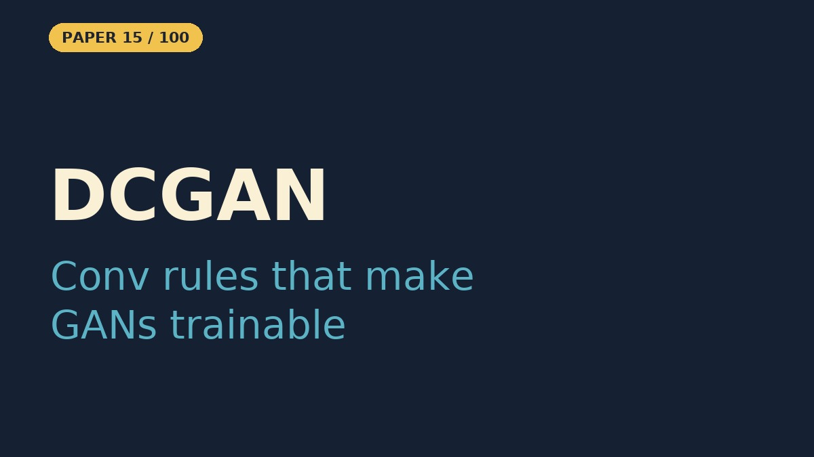

# DCGAN — Unsupervised Representation Learning with Deep Convolutional Generative Adversarial Networks

- **Paper:** [Unsupervised Representation Learning with Deep Convolutional Generative Adversarial Networks](https://arxiv.org/abs/1511.06434)
- **Authors:** Alec Radford, Luke Metz, Soumith Chintala
- **Lab, year:** indico Research & Facebook AI Research, 2015
- **Video:** [Watch the YouTube Short](https://youtube.com/shorts/eBFMevtU7DM) on [Backprop Daily](https://www.youtube.com/@BackpropDaily)

## Summary

The DCGAN paper bridges a critical gap in deep learning: while convolutional neural networks (CNNs) had achieved tremendous success in *supervised* tasks like image classification, their use in *unsupervised* learning — learning useful representations from data without labels — had lagged far behind. The authors propose a specific family of CNN architectures called **Deep Convolutional GANs (DCGANs)** that combine the adversarial training framework of GANs (Goodfellow et al., 2014) with convolutional architectures, guided by a set of empirically discovered architectural constraints that make training stable.

The core idea is to train a generator network (that maps random noise to images) and a discriminator network (that classifies images as real or fake) in an adversarial game. The generator tries to fool the discriminator; the discriminator tries to catch the generator. Through this competition, both networks improve, and the discriminator's internal features turn out to be excellent general-purpose image representations that can be reused for supervised tasks.

## What Problem Does It Solve

Imagine you have a giant box of photographs — bedrooms, faces, animals — but nobody has written labels on any of them. You can't ask "which ones are cats?" because there's no answer key. This is the *unsupervised* problem: how do you learn anything useful from pictures when nobody tells you what's in them?

Before this paper, people who tried to make AI generate new images using a technique called GANs (where two AIs compete — one makes fakes, one tries to detect them) kept running into a wall. The images looked like blurry noise, or the AI would crash and produce garbage. It was like trying to teach someone to paint by blindfolding them and saying "just figure it out" — they'd make a mess.

The DCGAN paper said: "Here are the exact rules for how to build these competing AIs so they actually work." They figured out the right combination of building blocks — like using special types of math operations (convolutions) instead of pooling, adding a stabilizer called batch normalization, and picking the right activation functions. Suddenly, the AI could generate surprisingly realistic images of bedrooms and faces from pure random noise, and the "detective" AI had learned to recognize objects (like beds and windows) without anyone ever telling it what those objects were. It's like the AI taught itself to understand what a "window" looks like just by looking at thousands of bedrooms, with no labels at all.

## Core Idea

- **Convolutional GANs that train stably:** pair the adversarial game of GANs (Goodfellow et al., 2014) with deep convolutional networks, following a small set of empirically found architecture rules.
- **Replace pooling with strided convolutions:** the discriminator downsamples with strided convolutions and the generator upsamples with fractional-strided (transposed) convolutions, so each network learns its own spatial resampling.
- **Batch normalization in both networks:** it stabilizes training and stops the generator from collapsing all samples to one point. It is *not* applied to the generator's output layer or the discriminator's input layer, because applying it to every layer caused sample oscillation and instability.
- **No fully connected hidden layers:** the generator's first layer projects the noise vector `z` and reshapes it into a 4D tensor, then only convolutions follow. The discriminator's last convolution is flattened into a single sigmoid output.
- **Activations:** ReLU in the generator (Tanh on the output) and LeakyReLU (slope 0.2) in the discriminator.
- **The discriminator is a feature extractor:** after adversarial training, its convolutional features transfer to supervised tasks without any labels having been used to learn them.

## Key Method Details

- **Optimizer:** Adam with learning rate 0.0002 (0.001 was too high) and `β₁ = 0.5` (the default 0.9 caused training oscillation and instability).
- **Initialization:** all weights drawn from a zero-centred normal distribution with standard deviation 0.02.
- **Batches and inputs:** mini-batch size 128; images scaled to `[-1, 1]` to match the Tanh output; 100-dimensional uniform noise `z`.
- **Generator shape:** `z` is projected to a `4×4×1024` tensor, then four fractional-strided convolutions upsample it to a `64×64×3` image.
- **Data:** LSUN bedrooms (about 3M images), ImageNet-1k, and a scraped faces dataset (about 350K face crops).
- **Feature-extraction result:** discriminator features plus a linear L2-SVM reach 82.8% accuracy on CIFAR-10, and a state-of-the-art 22.48% test error on SVHN with 1000 labels.
- **Latent-space arithmetic:** averaging the `z` vectors of three samples per concept gives stable vector arithmetic, e.g. *smiling woman − neutral woman + neutral man ≈ smiling man*, and *man with glasses − man without glasses + woman without glasses ≈ woman with glasses*.
- **Looking inside:** guided backpropagation shows discriminator features firing on beds and windows; dropping the generator's window-related feature maps makes it stop drawing windows and fill those regions with other objects.

### What the Notebook Result Shows

The notebook trains a DCGAN with the paper's guidelines and generator width (1024 channels at 4×4; 12.66M generator and 2.77M discriminator parameters) on CIFAR-10 resized to 64×64, for 15 epochs (5,850 iterations, about 30 to 38 minutes on a Tesla T4 across runs), far shorter than the paper's ~117K iterations on LSUN. The losses **oscillate and never converge**: the generator loss spikes to about 24 early, then swings mostly between 1 and 7, and in the last third of training the discriminator loss repeatedly drops close to 0. The run ends with the discriminator ahead (last-epoch averages **Loss_D 0.57, Loss_G 3.70**). The samples get CIFAR-like colours and layouts from about epoch 6 and stay varied (no mode collapse), but remain blurry with no clearly recognisable objects. The latent walk between two noise vectors changes gradually, with no sudden jumps. This toy does not attempt the paper's feature-extraction or face-arithmetic results.

## Influence

DCGAN became one of the most cited papers in generative modeling. Its architectural guidelines became the de facto standard for convolutional GANs and were used as the starting point for nearly all subsequent GAN architectures (WGAN, Pix2Pix, CycleGAN, StyleGAN). The PyTorch and TensorFlow tutorials for GANs are built around the DCGAN architecture. The paper also popularized latent-space arithmetic as a tool for understanding generative models, a concept that later extended to StyleGAN and diffusion models.

---

## Resources

| File | Description |
|------|-------------|
| [README.md](README.md) | This overview — a 5-minute read covering the paper's summary, core idea, key method details, influence, and a plain-English explanation of the problem it solves |
| [solution.ipynb](https://nbviewer.org/github/nadeemcite/research-papers/blob/main/023_dcgan-unsupervised-representation-learning/solution.ipynb) | Complete from-scratch PyTorch implementation of the paper's architecture, with training loops, visualizations, and worked examples |
| [CODE_ARCHITECTURE.md](CODE_ARCHITECTURE.md) | Section-by-section breakdown of the notebook — what each cell does, data flow, tensor shapes, and key design decisions |
| [TALK.md](TALK.md) | Press coverage, blog posts, Q&A (answers from the paper), citations, and common misconceptions about the paper |
