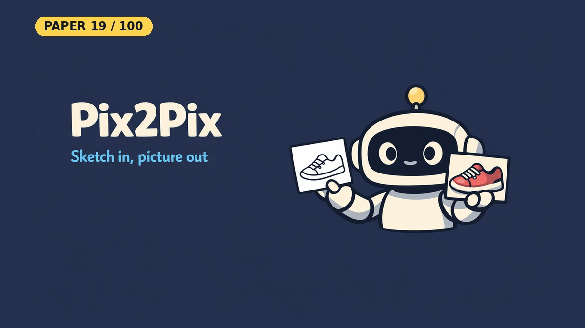

# Image-to-Image Translation with Conditional Adversarial Networks (Pix2Pix)

- **Paper:** [Image-to-Image Translation with Conditional Adversarial Networks](https://arxiv.org/abs/1611.07004)
- **Authors:** Phillip Isola, Jun-Yan Zhu, Tinghui Zhou, Alexei A. Efros
- **Lab, year:** Berkeley AI Research (BAIR), UC Berkeley, 2016 (CVPR 2017)
- **Video:** [Watch the YouTube Short](https://youtube.com/shorts/OnbtZtj-K5c) on [Backprop Daily](https://www.youtube.com/@BackpropDaily)

## Summary

Pix2Pix is a general-purpose framework for image-to-image translation using conditional Generative Adversarial Networks (cGANs). Before it, each translation task (edges→photos, labels→scenes, colorization) needed its own hand-designed loss function. The authors show that one architecture, a U-Net generator paired with a PatchGAN discriminator and trained with a combined cGAN + L1 loss, gives good results across many tasks.

The key insight is that the discriminator learns the loss function automatically. It learns to tell real image pairs from fake ones, which pushes the generator to make outputs that look structurally realistic, not just close pixel by pixel.

The U-Net's skip connections carry low-level detail (edges, color positions) across the network, while its bottleneck captures high-level content. The PatchGAN discriminator judges small image patches (N×N) rather than the whole image. It acts like a texture loss that enforces crisp high-frequency detail, while L1 takes care of low-frequency correctness.

## What Problem Does It Solve

Imagine you have a black-and-white coloring book outline and you want a computer to fill in realistic colors. Or you have a rough sketch of a shoe and want to see what the real shoe would look like. Before Pix2Pix, each of these tasks needed its own specially designed program. It was like needing a different translator for every pair of languages.

Pix2Pix is like one universal translator. You show it lots of "before" and "after" pairs (like outline→colored photo), and it works out the transformation on its own, with no hand-written rules for each task.

The clever trick is that nobody tells the computer exactly what "good" looks like. A second AI (the discriminator) learns to judge whether the output looks realistic, and the main AI (the generator) keeps improving until it can fool that judge. Together they learn both the translation and the quality measure.

## Core Idea

The method treats image-to-image translation as a conditional GAN problem: the generator G maps an input image x to an output image y (G: {x, z} → y), and the discriminator D learns to distinguish real {x, y} pairs from fake {x, G(x, z)} pairs. The final objective is:

**L_cGAN(G, D) + λ · L_L1(G)**

where L_cGAN is the adversarial loss and L_L1 is the pixel-wise L1 distance between generated and target images (L1 is preferred over L2 because it produces less blurring). The L1 term ensures coarse correctness (overall structure and color), while the cGAN term enforces sharp, realistic high-frequency detail.

## Key Method Details

- **U-Net Generator:** An encoder-decoder with skip connections between mirrored layers (layer i concatenates with layer n-i). This shuttles low-level information (edges, gradients) directly across the bottleneck. In the paper's Table 2, it scores far better than a plain encoder-decoder.
- **PatchGAN Discriminator:** Instead of classifying the entire image as real/fake, the discriminator evaluates N×N patches (70×70 in the paper) and averages the responses. This models the image as a Markov random field, assuming independence beyond a patch diameter, and effectively acts as a texture/style loss. It has fewer parameters, runs faster, and can operate on arbitrarily large images.
- **Noise via Dropout:** Rather than feeding explicit noise z, the generator uses dropout on several layers at both train and test time, providing minor stochasticity.
- **Optimization:** Adam optimizer with lr=0.0002, β1=0.5, β2=0.999. The discriminator objective is halved to slow its learning relative to the generator. Batch normalization at test time uses batch statistics (effectively instance normalization when batch size = 1).

### What the Notebook Result Shows

The notebook trains a U-Net (41.8M parameters) and a 70×70 PatchGAN (2.8M) on the first 200 edges→shoes pairs at 128×128, for 4 epochs at batch size 4: just 200 steps on a Tesla T4. The average generator loss falls from **48.6 to 32.0**, and the discriminator loss stays between 0.34 and 0.47.

The outputs are poor: blurry, covered in a checkerboard pattern, and only roughly following the shoe's shape, with colours that don't match the targets. The run shows the architecture and losses working end to end, not the paper's quality; for this task the paper trains 15 epochs on about 50,000 images.

The notebook has no ablation, so it does not test what skip connections or the cGAN term add. Those results come from the paper's Tables 1 and 2.

## Influence

Pix2Pix was followed by CycleGAN, pix2pixHD, SPADE and a wider line of conditional image-to-image translation research. Its code release also spread well beyond research: Christopher Hesse's [#edges2cats demo](https://affinelayer.com/pix2pix/) went viral and was [covered by The Verge](https://www.theverge.com/2017/2/21/14678230/edge2cat-machine-learning-tensorflow-ai-drawing-cthulu-take-the-wheel), and the [project page](https://phillipi.github.io/pix2pix/) collects community projects built on the code.

---

## Resources

| File | Description |
|------|-------------|
| [README.md](README.md) | This overview — a 5-minute read covering the paper's summary, core idea, key method details, influence, and a plain-English explanation of the problem it solves |
| [solution.ipynb](https://nbviewer.org/github/nadeemcite/research-papers/blob/main/025_image-to-image-translation-with-conditional/solution.ipynb) | Complete from-scratch PyTorch implementation of the paper's architecture, with training loops, visualizations, and worked examples |
| [CODE_ARCHITECTURE.md](CODE_ARCHITECTURE.md) | Section-by-section breakdown of the notebook — what each cell does, data flow, tensor shapes, and key design decisions |
| [TALK.md](TALK.md) | Press coverage, blog posts, Q&A (answers from the paper), citations, and common misconceptions about the paper |
