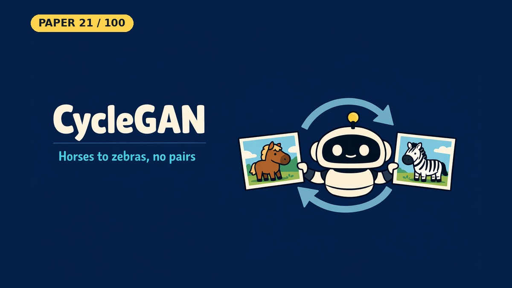

# CycleGAN: Unpaired Image-to-Image Translation

- **Paper:** [Unpaired Image-to-Image Translation using Cycle-Consistent Adversarial Networks](https://arxiv.org/abs/1703.10593)
- **Authors:** Jun-Yan Zhu, Taesung Park, Phillip Isola, Alexei A. Efros
- **Lab, year:** UC Berkeley (BAIR), 2017 (ICCV 2017)
- **Video:** [Watch the YouTube Short](https://youtube.com/shorts/eVLY-jkiFpw) on [Backprop Daily](https://www.youtube.com/@BackpropDaily)

## Summary

CycleGAN learns to translate images from one domain to another, such as horses to zebras or summer to winter, **without paired training examples**. Earlier methods like Pix2Pix need aligned input and output pairs, which are expensive or impossible to collect for many tasks.

CycleGAN trains two generators in opposite directions, each with a discriminator judging its output. A **cycle consistency loss** requires that an image translated to the other domain and back returns to the original, so F(G(x)) should be close to x. That constraint is what lets it learn from two unmatched piles of images.

## What Problem Does It Solve

Imagine you have a pile of horse photos and a separate pile of zebra photos, but nobody ever photographed the same animal in the same pose both ways. You want a program that turns any horse photo into a zebra photo. Older programs needed "before and after" pairs, and those do not exist here.

CycleGAN learns from the two separate piles. It checks that turning a horse into a zebra and back gives the original horse again. This round-trip check is what stops the program from producing any old zebra that has nothing to do with the input.

## Core Idea

The method has two generators, G (X to Y) and F (Y to X), and two discriminators: D_Y tells real Y from G's fakes, and D_X tells real X from F's fakes. Adversarial losses alone only match the overall look of a domain, so many mappings would satisfy them.

The **cycle consistency loss** narrows this down. It is the L1 distance between F(G(x)) and x, plus the same for G(F(y)) and y. Together the two mappings have to be near-inverses of each other, which ties each output to its input.

## Key Method Details

- **Generators:** two downsampling convolutions, then residual blocks (6 for 128×128 images, 9 for 256×256), then two upsampling layers, with instance normalization.
- **Discriminators:** a 70×70 PatchGAN, which judges overlapping image patches as real or fake. It is C64-C128-C256-C512 plus a final convolution, five layers in all.
- **Losses:** adversarial loss in LSGAN form (mean squared error) plus cycle consistency with weight λ = 10.
- **Identity loss:** an optional term with weight 0.5λ that keeps a generator near the identity on images already in its target domain. The paper uses it on some tasks, such as painting to photo, to preserve color.
- **Training:** Adam at learning rate 0.0002, batch size 1, 100 epochs at that rate and then 100 epochs of linear decay, with a history buffer of 50 earlier fakes for the discriminators.
- **Limitations (Section 6):** it often succeeds on color and texture changes but had little success on geometric ones. On dog to cat, the translation degenerates into minimal changes to the input.

### What the Notebook Result Shows

The notebook uses 128×128 images, 4 residual blocks and synthetic data: warm circles against cool squares, with no pairs. It trains for 60 epochs of 200 images per domain, without learning-rate decay or a history buffer.

Translation worked in both directions: circles became blue squares and squares became orange circles, in the same place. In this run, generated circles have a warmth of **0.59** (real ones 0.60) and a box fill of **0.78** (real ones 0.75). Generated squares have a warmth of **-0.53** (real ones -0.54), but reach only **0.84** of their box against 1.00 for real ones, because their corners are soft.

Cycle error is **0.078** and **0.080** on the [-1, 1] pixel scale, and reconstructions are blurrier than the originals. GPU runs with the same seed differ noticeably: in two earlier runs generated circles measured 0.58 and 0.77 box fill, so treat these as one run's values. Generated backgrounds do not copy the input's, and faint halos remain. These shapes are far simpler than the real photos the paper's failures involve.

## Influence

CycleGAN became one of the best-known papers in image-to-image translation. It was followed by UNIT, MUNIT, DRIT and multi-domain methods such as StarGAN, and it is used for artistic style transfer, domain adaptation and data augmentation. [OpenAlex](https://openalex.org/W2962793481) records 24,419 citations as of 9 Nov 2026.

---

## Resources

| File | Description |
|------|-------------|
| [README.md](README.md) | This overview — a 5-minute read covering the paper's summary, core idea, key method details, influence, and a plain-English explanation of the problem it solves |
| [solution.ipynb](https://nbviewer.org/github/nadeemcite/research-papers/blob/main/026_cyclegan-unpaired-image-translation/solution.ipynb) | Complete from-scratch PyTorch implementation of the paper's architecture, with training loops, visualizations, and worked examples |
| [CODE_ARCHITECTURE.md](CODE_ARCHITECTURE.md) | Section-by-section breakdown of the notebook — what each cell does, data flow, tensor shapes, and key design decisions |
| [TALK.md](TALK.md) | Press coverage, blog posts, Q&A (answers from the paper), citations, and common misconceptions about the paper |
