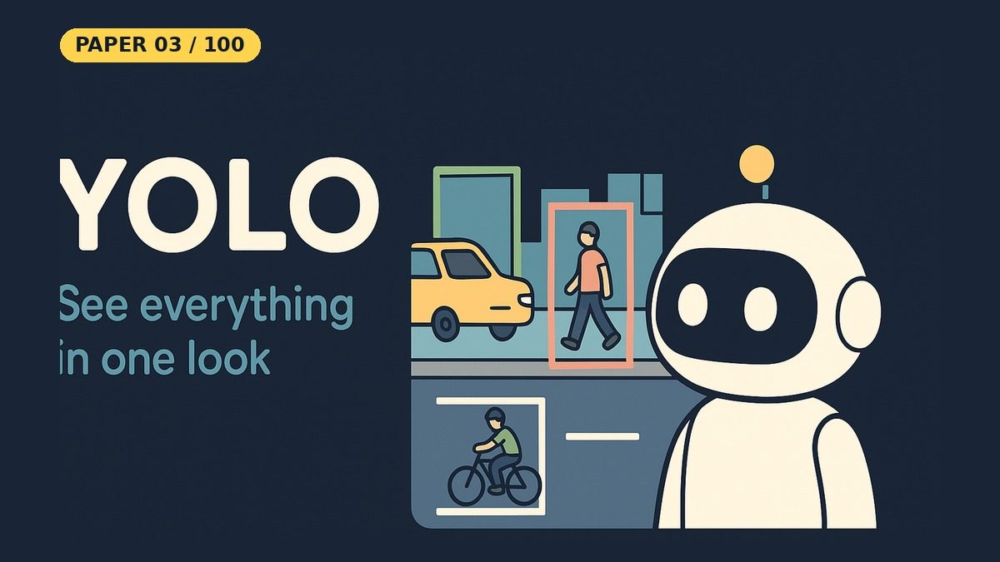

# You Only Look Once: Unified, Real-Time Object Detection (YOLO)

- **Paper:** [You Only Look Once: Unified, Real-Time Object Detection](https://arxiv.org/abs/1506.02640)
- **Authors:** Joseph Redmon, Santosh Divvala, Ross Girshick, Ali Farhadi
- **Lab, year:** University of Washington, Allen Institute for AI and Facebook AI Research, 2015 ([CVPR 2016](https://openaccess.thecvf.com/content_cvpr_2016/html/Redmon_You_Only_Look_CVPR_2016_paper.html))
- **Video:** YouTube Short coming on 18 Oct 2026 on [Backprop Daily](https://www.youtube.com/@BackpropDaily)

## Summary

YOLO reframes object detection as a single regression problem. Instead of running a classifier over many candidate regions (R-CNN checks about 2,000 proposed boxes per image; DPM slides a classifier across the image), YOLO uses a single convolutional network to simultaneously predict all bounding boxes and class probabilities for an entire image in one forward pass. The image is divided into a 7×7 grid; each grid cell predicts bounding box coordinates (x, y, w, h) and class-conditional probabilities for the objects whose centers fall within that cell. This unified architecture processes images at 45 FPS (155 FPS for Fast YOLO), making it one of the first deep-learning detectors fast enough for live video. The network is trained end-to-end with a multi-part sum-squared-error loss that balances localization and classification errors, using λ_coord = 5 to up-weight coordinate predictions. Bounding box dimensions use square-root parameterization so that errors in small boxes are penalized proportionally more than errors in large boxes.

## What Problem Does It Solve

Imagine you're looking at a photo of a busy street and you need to quickly point out every person, car, and bicycle — not just say "there's a car somewhere" but draw a box around each one and label it. Before YOLO, computers did this in a very roundabout way: they'd propose about 2,000 possible boxes in the photo, check each box one by one with a "what is this?" classifier, and then try to clean up and combine the answers. This was slow (taking seconds per photo) and often resulted in the computer "seeing" objects that weren't really there because it was looking at small patches without understanding the whole picture. YOLO solved this by looking at the entire photo all at once — just like a human does — and directly predicting where every object is and what it is, in a single glance. That's why it's called "You Only Look Once."

## Core Idea

- **Unified detection:** A single CNN predicts bounding boxes and class probabilities simultaneously from the full image — no region proposal step, no separate classifier.
- **Grid-based prediction:** The input image (448×448) is divided into a 7×7 grid. Each grid cell predicts B bounding boxes (the paper uses B=2; this repo's notebook uses B=1) with confidence scores, plus C conditional class probabilities (20 classes for PASCAL VOC).
- **Output tensor:** The final layer produces a 7×7×(5*B + C) tensor. With B=2 and C=20, that's 7×7×30.
- **Loss function:** Multi-part sum-squared error with λ_coord = 5 in the paper (up-weighting localization) and λ_noobj = 0.5 (down-weighting boxes without objects). Square-root parameterization for width/height.
- **Architecture:** 24 convolutional layers (inspired by GoogLeNet, using 1×1 reduction + 3×3 conv layers) followed by 2 fully connected layers. Max-pooling layers and two stride-2 convolutions handle downsampling.
- **Training:** Pretrained on ImageNet (first 20 conv layers, ~1 week), then fine-tuned for detection on PASCAL VOC 2007/2012. ~135 epochs, batch size 64, momentum 0.9, dropout 0.5.
- **Speed:** 45 FPS (base), 155 FPS (Fast YOLO with 9 conv layers).

## Key Method Details

- **Objectness score:** Each predicted bounding box carries a confidence = Pr(Object) × IOU(pred, truth). This decouples "is there something?" from "what is it?". The imbalance from mostly-empty grid cells is handled separately, by the loss: empty cells count with weight λ_noobj = 0.5.
- **Conditional class probabilities:** Pr(Class_i \| Object) — only updated at cells containing an object. Final detection score = Pr(Class_i \| Object) × Pr(Object) × IOU.
- **Non-maximal suppression:** Post-processing to remove duplicate detections of the same object; adds 2-3% mAP.
- **Leaky ReLU** activation (0.1 slope for negative inputs) in every layer except the last, which is linear in the paper (the notebook applies a sigmoid to bound outputs to [0, 1]).

### Simplifications in This Notebook

- Smaller network: 10 conv layers with BatchNorm (BatchNorm came later, in YOLOv2) and max-pooling, + 2 fully connected layers, about 7.2 million parameters
- Input size 224×224 instead of 448×448
- Synthetic toy dataset (red circles, green rectangles, blue triangles on a black background) instead of PASCAL VOC: 3,000 new training images every epoch, and 200 fixed test images
- B=1 bounding box per cell (the paper uses B=2), and at most one shape per cell
- 3 classes instead of 20
- 20 epochs with Adam instead of ~135 epochs with SGD, and no ImageNet pretraining
- Object-cell confidence target is 1 instead of the predicted box's IoU; sigmoid output instead of a linear last layer

### What the Notebook Result Shows

On 200 test images it never trained on, the notebook's detector reaches **mAP@0.5 of about 0.90** (circle 0.91, rectangle 0.91, triangle 0.89), and about 95–96% of the shapes get a correct box (the exact figure shifts slightly between runs, e.g. GitHub vs Kaggle). Most predicted boxes are tight; the typical mistakes are boxes a bit too large or small on thin or oddly shaped triangles. This toy task is far easier than the paper's, so the number is **not** comparable to YOLO's 63.4% mAP on PASCAL VOC 2007; it shows that the grid targets, the multi-part loss and the decoding work together as a real detector.

## Influence

YOLO changed object detection by showing that a single neural network could detect many kinds of objects at real-time speed. It won the [OpenCV People's Choice Award at CVPR 2016](https://pjreddie.com/publications/yolo/). It spawned an entire family of models (YOLOv2/YOLO9000 and YOLOv3 by the original authors, then YOLOv4, YOLOv5, YOLOv8, YOLOv10, YOLO11 and others by different teams) that remain among the most widely used detectors in both research and industry. The original YOLO paper has been cited about 53,000 times ([OpenAlex](https://openalex.org/works/W1483870316), checked October 2026) and is one of the most influential computer vision papers of the 2010s. Its framing of detection as a regression problem influenced single-stage detectors like SSD and RetinaNet.

---

## Resources

| File | Description |
|------|-------------|
| [README.md](README.md) | This overview — a 5-minute read covering the paper's summary, core idea, key method details, influence, and a plain-English explanation of the problem it solves |
| [solution.ipynb](https://nbviewer.org/github/nadeemcite/research-papers/blob/main/032_you-only-look-once-yolo/solution.ipynb) | From-scratch PyTorch YOLO detector trained on a toy shapes dataset: grid targets, multi-part loss, NMS and mAP@0.5 evaluation (about 0.90 on unseen test images) |
| [CODE_ARCHITECTURE.md](CODE_ARCHITECTURE.md) | Section-by-section breakdown of the notebook — what each cell does, data flow, tensor shapes, and key design decisions |
| [TALK.md](TALK.md) | Press coverage, blog posts, interview Q&A, citations, and common misconceptions about the paper |
