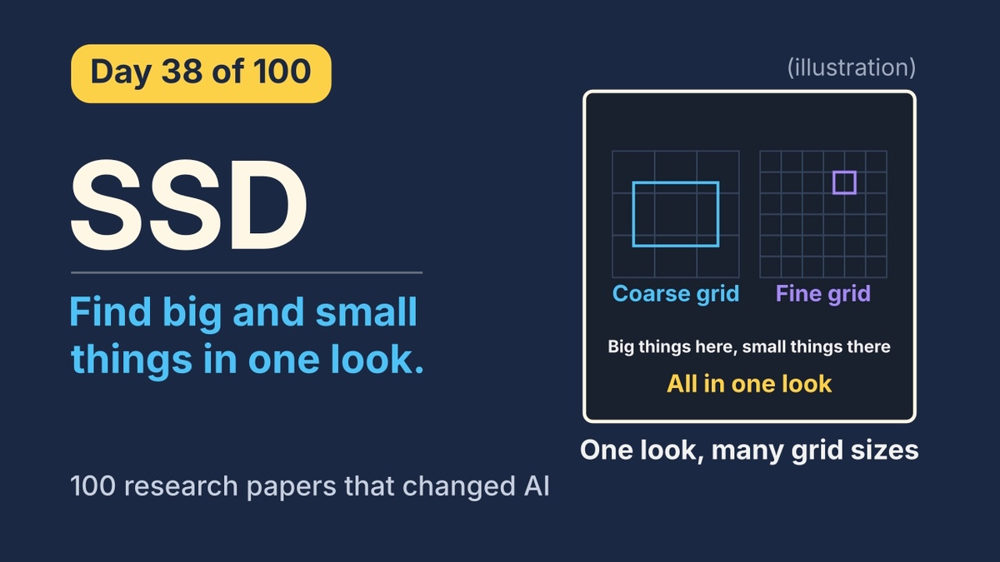

# SSD: Single Shot MultiBox Detector

- **Paper:** [SSD: Single Shot MultiBox Detector](https://arxiv.org/abs/1512.02325)
- **Authors:** Wei Liu, Dragomir Anguelov, Dumitru Erhan, Christian Szegedy, Scott Reed, Cheng-Yang Fu, Alexander C. Berg
- **Lab, year:** UNC Chapel Hill, Zoox, Google and University of Michigan, 2016 (ECCV 2016)
- **Video:** YouTube Short coming on 22 Nov 2026 on [Backprop Daily](https://www.youtube.com/@BackpropDaily)

## Summary

SSD is an object detector that finds every box and its class in a single pass of one network, with no separate step that first proposes regions.

At the time, Faster R-CNN was accurate but ran at only 7 frames per second, and YOLO was fast but much less accurate. SSD attaches small predictors to several feature maps of decreasing resolution. Each cell of each map has a fixed set of "default boxes" of different sizes and shapes, and the network predicts a class score and small box adjustments for every one of them.

With a 300×300 input, SSD300 reached 74.3% mAP (mean average precision, the standard detection score) on PASCAL VOC2007 test at 59 FPS, against 73.2% at 7 FPS for Faster R-CNN and 63.4% at 45 FPS for YOLO.

## What Problem Does It Solve

Imagine being asked to point out every dog, ball and bench in a park photo. Some things are tiny, like a ball far away, and some are huge, like a bench right in front of the camera. Checking thousands of small pieces of the photo one by one is accurate but slow.

SSD looks once, but through several grids at the same time. A fine grid of small squares is good for spotting the tiny ball; a coarse grid of big squares is good for the bench. Every square already holds a few guess shapes (tall, wide, square), and the network just says for each guess: is something here, what is it, and how should the shape be nudged? Because all grids work in one pass, SSD finds big and small things fast enough for live video.

## Core Idea

1. **Multi-scale feature maps:** SSD uses a truncated VGG-16 plus extra conv layers that shrink the map step by step (38→19→10→5→3→1 for SSD300). Each of the 6 maps makes predictions (Section 2.1).
2. **Default boxes:** map *k* of *m* gets a scale `s_k = s_min + (s_max − s_min)(k − 1)/(m − 1)` with `s_min = 0.2` and `s_max = 0.9`, aspect ratios `{1, 2, 3, 1/2, 1/3}` and one extra square box of scale `√(s_k·s_{k+1})` (Section 2.2). SSD300 has 8,732 default boxes.
3. **Convolutional predictors:** a 3×3 conv on each map outputs class scores and 4 box offsets for every default box at each location.
4. **Matching and loss:** each ground-truth box is matched to its best default box and to every default box with Jaccard overlap (IoU) above 0.5. The loss is a softmax confidence loss plus a Smooth L1 localization loss on the matched boxes (Section 2.2).
5. **Hard negative mining:** most default boxes are background, so SSD keeps only the hardest negatives, at most 3 negatives per positive (Section 2.2).

## Key Method Details

- **Backbone:** ImageNet-pretrained VGG-16 with `fc6`/`fc7` turned into conv layers (an atrous, or dilated, `fc6`). The early `conv4_3` map is L2-normalized with a learned scale starting at 20 (Section 3.1).
- **Data augmentation:** random crops with minimum IoU {0.1, 0.3, 0.5, 0.7, 0.9}, random patches and horizontal flips. This sampling improved mAP by 8.8% (Section 3.2, Table 2). A later "zoom out" expansion added 2–3% mAP and helped small objects (Section 3.6).
- **Inference:** confidence threshold 0.01, per-class NMS at IoU 0.45, top 200 detections per image (Section 3.7).
- **Results:** SSD300 74.3% and SSD512 76.8% mAP on VOC2007 test (Table 1; the abstract rounds SSD512 to 76.9%); on COCO test-dev, SSD512 reached 26.8 AP (46.5 AP at IoU 0.5) (Table 5).

### Simplifications in This Notebook

- A synthetic dataset of circles, rectangles and triangles (4,000 training and 500 validation images, 256×256). Object sizes are log-uniform from 16 to 170 px (rectangles get a random aspect ratio, so they reach up to about 254 px on their long side), so several scales are needed.
- A small VGG-style backbone with BatchNorm, trained from scratch, with 6 source maps (32, 16, 8, 4, 2, 1) and 6,132 default boxes. The 32×32 map is L2-normalized, as in the paper.
- From-scratch default boxes with the paper's `s_k` formula, the two-step matching, box encoding, the MultiBox loss with 3:1 hard negative mining, per-class NMS and VOC-style mAP@0.5.
- AdamW with a one-cycle schedule and mixed precision for 50 epochs, and horizontal flips only (no random crops or zoom-out).

### What the Notebook Result Shows

The detector works well on this toy task: mAP@0.5 was **0.959** (AP circle 0.970, rectangle 0.960, triangle 0.948). Recall was **0.891** for small objects (< 32 px), **0.966** for medium and **0.995** for large (> 96 px), so small objects are the hardest, as in the paper. Detections come from the map whose default boxes fit the object: the median detected size grows from 29.5 px on the 32×32 map to 164 px on the 4×4 map.

Training took 50 epochs (16.4 minutes on a T4 GPU). The validation confidence loss was lowest around epoch 15 (0.701) and rose to 0.830 by epoch 50 while the training loss kept falling, a sign of mild overfitting. These numbers come from clean synthetic shapes and are not comparable to the paper's VOC results.

## Influence

OpenAlex lists about 33,200 citations for the ECCV version ([33,222 when checked on 21 November 2026](https://openalex.org/W2193145675)). Google's [TensorFlow Object Detection API](https://research.google/blog/supercharge-your-computer-vision-models-with-the-tensorflow-object-detection-api/) launched in 2017 with SSD + MobileNet models for real-time mobile use, and [MobileNetV2](https://arxiv.org/abs/1801.04381) introduced the lighter SSDLite. Later detectors such as [Feature Pyramid Networks](https://arxiv.org/abs/1612.03144) and [RetinaNet](https://arxiv.org/abs/1708.02002) also predict from several feature-map resolutions, and [torchvision](https://pytorch.org/blog/torchvision-ssd-implementation/) ships an SSD implementation.

---

## Resources

| File | Description |
|------|-------------|
| [README.md](README.md) | This overview: a 5-minute read covering the paper's summary, core idea, key method details, influence, and a plain-English explanation of the problem it solves |
| [solution.ipynb](https://nbviewer.org/github/nadeemcite/research-papers/blob/main/033_ssd-single-shot-multibox-detector/solution.ipynb) | From-scratch PyTorch SSD: multi-scale default boxes, matching, MultiBox loss with hard negative mining, NMS and mAP on synthetic shapes |
| [CODE_ARCHITECTURE.md](CODE_ARCHITECTURE.md) | Section-by-section breakdown of the notebook: what each cell does, data flow, tensor shapes, and key design decisions |
| [TALK.md](TALK.md) | Press coverage, Q&A (answers from the paper), citations, and common misconceptions about the paper |
