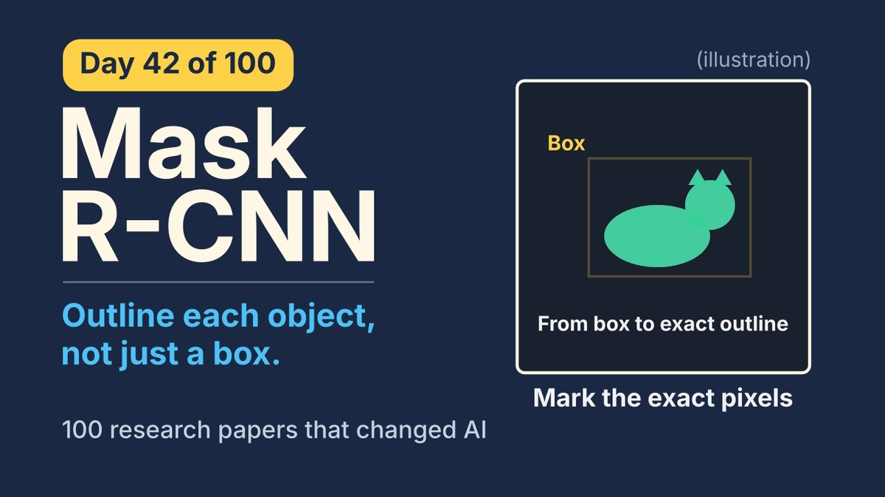

# Mask R-CNN

- **Paper:** [Mask R-CNN](https://arxiv.org/abs/1703.06870)
- **Authors:** Kaiming He, Georgia Gkioxari, Piotr Dollár, Ross Girshick
- **Lab, year:** Facebook AI Research (FAIR), 2017 (ICCV 2017)
- **Video:** YouTube Short coming on 26 Nov 2026 on [Backprop Daily](https://www.youtube.com/@BackpropDaily)

## Summary

Mask R-CNN does instance segmentation: it finds every object in an image, says what it is, and marks exactly which pixels belong to it, separately for each object.

It starts from Faster R-CNN, which already finds objects and draws boxes around them, and adds a small extra branch that predicts a mask for each detected object, in parallel with the box and class outputs.

Two details make the masks accurate: RoIAlign, which reads each object's features without rounding positions, and per-class masks that do not compete with each other. With a ResNet-101-FPN backbone (the image feature network underneath) it reached 35.7 mask AP on COCO and ran at about 5 frames per second.

## What Problem Does It Solve

Picture a photo of five cars parked side by side. An object detector draws a box around each car, but the boxes overlap and include bits of road and of the neighbouring cars. Semantic segmentation colours every car pixel the same, so you can't tell where one car ends and the next begins.

Instance segmentation gives each car its own exact outline. Mask R-CNN does this by first finding each car, then cutting out the region around it and drawing that one car's mask, one object at a time, but all in one network.

## Core Idea

Mask R-CNN has three parallel outputs for each candidate object:

1. **Class label:** what the object is.
2. **Box offset:** where exactly its box is.
3. **Binary mask:** which pixels belong to it.

The mask branch is a small fully convolutional network (FCN) applied to each region's features. It outputs one m×m mask per class with a per-pixel sigmoid, and only the mask of the object's class is used, so classes do not compete (Section 3).

## Key Method Details

- **RoIAlign:** RoIPool rounds each region and its bins to the feature grid, which shifts the features against the region. RoIAlign removes all rounding and uses bilinear interpolation at regularly sampled points (Section 3). With ResNet-50-C4 it raised mask AP from 26.9 to 30.3 (Table 2c).
- **Decoupled masks:** a per-pixel sigmoid with a binary loss per class, instead of a softmax over classes; the softmax version scored 24.8 vs 30.3 mask AP (Table 2b).
- **Multi-task loss:** L = L_cls + L_box + L_mask, where the mask loss is only defined on positive RoIs (IoU ≥ 0.5) and only for the ground-truth class (Section 3).
- **Backbones:** ResNet and ResNeXt, with C4 heads or Feature Pyramid Networks (FPN); FPN gave the best results (Table 2a).
- **Training:** 160k iterations, learning rate 0.02 (×0.1 at 120k), momentum 0.9, weight decay 0.0001, 8 GPUs with 2 images each; 64 RoIs per image for C4 and 512 for FPN, with a 1:3 ratio of positives to negatives (Section 3.1).
- **Inference:** 1000 proposals for FPN, then NMS, then the mask branch on the top 100 detections (Section 3.1).

Results on COCO test-dev (Table 1):

| Backbone | mask AP | AP50 | AP75 |
|---|---|---|---|
| ResNet-101-C4 | 33.1 | 54.9 | 34.8 |
| ResNet-101-FPN | 35.7 | 58.0 | 37.8 |
| ResNeXt-101-FPN | 37.1 | 60.0 | 39.4 |

The models run at about 200 ms per frame on a GPU, and Mask R-CNN outperformed the previous single-model entries on COCO instance segmentation, box detection and keypoint detection.

### Simplifications in This Notebook

The notebook builds a small Mask R-CNN in PyTorch and trains it on synthetic 128×128 images of rectangles, circles and triangles (400 for training, 100 for testing). It has a 4-block CNN backbone (stride 16, no FPN), an RPN with 9 anchors per cell, RoIAlign, and parallel box and mask branches with per-class sigmoid masks. RoIAlign is written from scratch for illustration, but training uses torchvision's `roi_align` for speed. It trains with Adam for 6 epochs on the CPU and reports mask AP at IoU 0.5.

### What the Notebook Result Shows

After the fixes described below, mask mAP@0.5 on the 100 test images was **0.838** (rectangle **0.890**, circle **0.839**, triangle **0.786**), and correct detections overlapped the ground-truth masks with a mean IoU of **0.744**. All loss parts fell during training (total 1.36 → 0.51). Most shapes get the right box, class and mask; the visible failures are overlapping shapes, where a partly hidden shape can be missed or merged with its neighbour.

This is an easy synthetic task, so 0.838 is not comparable to the paper's COCO numbers. An earlier version of this notebook reported 0.0000 mAP, because its training pooled every region from the first image of each batch, its masks were never pasted back into the image, and it trained for only 4 epochs on 200 images.

## Influence

OpenAlex lists about 34,800 citations for the ICCV version ([34,767 when checked on 25 November 2026](https://openalex.org/W2963150697)). It ships as a ready-made model in [torchvision](https://docs.pytorch.org/vision/stable/models/mask_rcnn.html) and in FAIR's [Detectron](https://github.com/facebookresearch/Detectron) and [Detectron2](https://github.com/facebookresearch/detectron2) libraries, and later instance-segmentation methods such as [SOLOv2](https://arxiv.org/abs/2003.10152) compare against it.

---

## Resources

| File | Description |
|------|-------------|
| [README.md](README.md) | This overview — a 5-minute read covering the paper's summary, core idea, key method details, influence, and a plain-English explanation of the problem it solves |
| [solution.ipynb](https://nbviewer.org/github/nadeemcite/research-papers/blob/main/034_mask-r-cnn/solution.ipynb) | A small Mask R-CNN in PyTorch (from-scratch RoIAlign for illustration, torchvision RoIAlign for training) on synthetic shapes, with mask mAP evaluation |
| [CODE_ARCHITECTURE.md](CODE_ARCHITECTURE.md) | Section-by-section breakdown of the notebook — what each cell does, data flow, tensor shapes, and key design decisions |
| [TALK.md](TALK.md) | Press coverage, Q&A (answers from the paper), citations, and common misconceptions about the paper |
