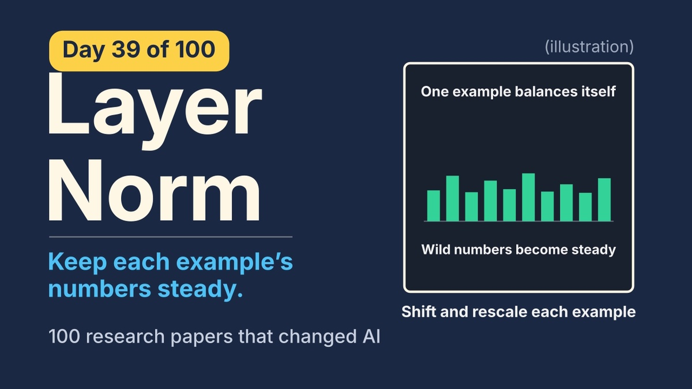

# Layer Normalization

- **Paper:** [Layer Normalization](https://arxiv.org/abs/1607.06450)
- **Authors:** Jimmy Lei Ba, Jamie Ryan Kiros, Geoffrey E. Hinton
- **Lab, year:** University of Toronto, 2016
- **Video:** [Watch the YouTube Short](https://youtube.com/shorts/JpsGMD9E-g4) on [Backprop Daily](https://www.youtube.com/@BackpropDaily)

## Summary

Neural networks train faster when the numbers flowing into each layer stay in a steady range. Batch normalization did this by averaging over a batch of examples, but that is awkward for recurrent networks and impossible with one example at a time.

Layer normalization takes the mean and spread over all the units of one layer for a single example, then rescales that layer's inputs with them. It needs no batch, does the same thing in training and testing, and fits naturally into recurrent networks at every time step.

The paper tests it on six tasks with a focus on recurrent networks: image–sentence ranking, question answering, skip-thought sentence vectors ("contextual language modelling"), generating binarized MNIST digits with DRAW, handwriting generation, and classifying MNIST digits with a fully connected network that ignores the image layout ("permutation-invariant" MNIST). It often trained faster, and in several tasks it also generalized better.

## What Problem Does It Solve

Imagine a choir where some singers suddenly get much louder or quieter, and the rest of the song falls apart. A sound engineer could fix each singer's volume by comparing them with the same singer in many other recordings: that is batch normalization. It works well when there are many recordings at once, but not for a single live song, or for songs of different lengths.

Layer normalization balances the volume within one song: it looks at all the singers at that moment and evens them out. It works for one song at a time and at every moment of a long song, which is exactly what recurrent networks reading sentences need.

## Core Idea

- **Normalize across the layer, not the batch:** for a layer with H units and summed inputs a, compute μ = (1/H) Σ aᵢ and σ = √((1/H) Σ (aᵢ − μ)²), then use (aᵢ − μ)/σ (Section 3).
- **Learnable gain and bias:** each unit gets its own gain g and bias b, applied after normalization and before the non-linearity.
- **Same in training and testing:** the statistics come from the current example, so no running averages are needed, and it works with batch size 1 (Section 3).

## Key Method Details

- **In RNNs:** at every time step, the summed inputs a_t = W_hh h_{t−1} + W_xh x_t are normalized with their own μ_t and σ_t, with one gain and bias shared over all time steps. Test sequences can be longer than any training sequence (Section 3.1).
- **Invariances:** it is invariant to scaling the whole weight matrix and to shifting all incoming weights, and to re-scaling a single training case, but not to scaling one neuron's weight vector (Section 5.1, Table 1).
- **Results:** in image–sentence ranking it reached its best validation model in 60% of the baseline's time and generalized better (Section 6.1, Table 2); in question answering it trained faster and beat recurrent batch normalization (Section 6.2).
- **Limits:** in preliminary ConvNet experiments batch normalization did better, because units near the image boundary are rarely active and have very different statistics (Section 6.7).

### Simplifications in This Notebook

The notebook implements layer normalization from scratch in NumPy (with a gradient check) and PyTorch (checked against `nn.LayerNorm`). It compares a small tanh RNN without normalization, with a from-scratch BatchNorm and with LayerNorm on a synthetic task: 64 noisy features whose mean rises or falls over 20 time steps. It also trains a small pre-norm Transformer block with LayerNorm and a positional embedding, and repeats the RNN comparison with batch size 1.

### What the Notebook Result Shows

The from-scratch LayerNorm is correct: it matches PyTorch's `nn.LayerNorm` to 4.77e-07, and its gradients pass the finite-difference check. But **the toy task is too easy to separate the methods**: all three RNNs reach 100% test accuracy, BatchNorm actually got there first (after 1 epoch, the others after 3), and their final losses are almost the same. So this run does not show LayerNorm training faster.

The LayerNorm RNN's hidden-state size grows less over the 20 steps than without normalization (0.576 → 0.728 vs 0.610 → 0.978), but it still grows. The Transformer block reaches 100% test accuracy. With batch size 1, BatchNorm learns nothing (its loss stays at 0.693, the level of random guessing) and its test accuracy is close to chance, while both LayerNorm and no normalization reach 100%; that shows BatchNorm breaking, not LayerNorm winning.

## Influence

OpenAlex lists about 14,900 citations ([14,907 when checked on 22 November 2026](https://openalex.org/W3037932933)). A year later the [Transformer](https://arxiv.org/abs/1706.03762) used layer normalization after each of its sub-layers, citing this paper, and it is available as a built-in layer in PyTorch ([`torch.nn.LayerNorm`](https://docs.pytorch.org/docs/stable/generated/torch.nn.LayerNorm.html)).

---

## Resources

| File | Description |
|------|-------------|
| [README.md](README.md) | This overview — a 5-minute read covering the paper's summary, core idea, key method details, influence, and a plain-English explanation of the problem it solves |
| [solution.ipynb](https://nbviewer.org/github/nadeemcite/research-papers/blob/main/042_layer-normalization/solution.ipynb) | From-scratch LayerNorm in NumPy and PyTorch, compared with BatchNorm and no normalization in an RNN, plus a pre-norm Transformer block and a batch-size-1 test |
| [CODE_ARCHITECTURE.md](CODE_ARCHITECTURE.md) | Section-by-section breakdown of the notebook — what each cell does, data flow, tensor shapes, and key design decisions |
| [TALK.md](TALK.md) | Press coverage, Q&A (answers from the paper), citations, and common misconceptions about the paper |
