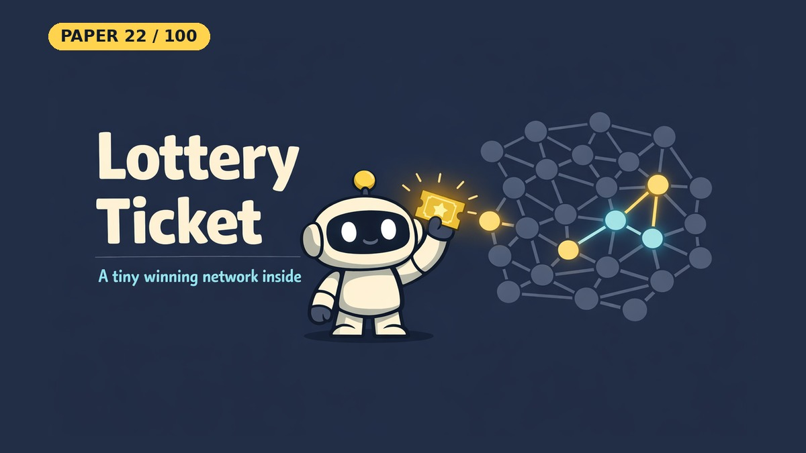

# The Lottery Ticket Hypothesis: Finding Sparse, Trainable Neural Networks

- **Paper:** [The Lottery Ticket Hypothesis: Finding Sparse, Trainable Neural Networks](https://arxiv.org/abs/1803.03635)
- **Authors:** Jonathan Frankle, Michael Carbin
- **Lab, year:** MIT CSAIL, 2018 (ICLR 2019)
- **Video:** [Watch the YouTube Short](https://youtube.com/shorts/q68WnzvntPM) on [Backprop Daily](https://www.youtube.com/@BackpropDaily)

## Summary

The Lottery Ticket Hypothesis says that a dense, randomly initialized neural network contains sparse subnetworks ("winning tickets") that, trained on their own, can reach test accuracy comparable to the original network in a similar number of iterations. What makes them special is not only their structure but also the *initial weights* of the surviving connections. The authors say these subnetworks "have won the initialization lottery".

To find them, the paper uses **iterative magnitude pruning (IMP)**: train the network, remove the smallest-magnitude weights, reset the survivors to their original starting values, and repeat. The tickets it finds are consistently less than 10-20% of the size of several fully-connected and convolutional networks on MNIST and CIFAR10. Above that size, they learn faster than the original network and reach higher test accuracy.

## What Problem Does It Solve

Imagine you have a giant box of 1,000 Lego pieces, but you only need about 150 of them to build your castle. The rest take up space and slow you down. The catch is that you don't know *which* 150 are the right ones until you have built the whole castle once.

People already knew that a trained network could be shrunk by removing unimportant connections (pruning) without hurting accuracy. But if you trained that small network from fresh random starting values, it did worse.

The authors found that keeping the *original starting weights* of the surviving connections makes the small network train well. It is as if those 150 pieces came with a head start. They called these lucky small networks "winning tickets".

## Core Idea

- **The hypothesis:** a randomly initialized network contains a subnetwork that, trained in isolation, can match the full network's test accuracy in at most the same number of iterations.
- **Winning ticket:** a mask (which connections to keep) plus the original initial values of those connections.
- **Iterative magnitude pruning:** (1) train, (2) prune a percentage of the remaining weights with the smallest absolute value, (3) reset the survivors to their original values, (4) repeat on the smaller network.
- **Initialization matters:** with the same mask but new random weights, networks learn more slowly and lose accuracy once they are heavily pruned.

## Key Method Details

- **Pruning rate:** 20% per round for the fully-connected MNIST model, with connections to the output layer pruned at half that rate. Conv-2, Conv-4 and Conv-6 prune their convolutional layers at 10-15% (Figure 2 of the paper).
- **Lenet on MNIST:** with 21% of the weights left, the ticket reached minimum validation loss 2.51x faster than when reinitialized and was half a percentage point more accurate.
- **Deeper networks:** on VGG-19 and Resnet-18 the method is sensitive to the learning rate and needs warmup at higher rates.

### Simplifications in This Notebook

The notebook prunes a `784 → 256 → 128 → 10` MLP on MNIST for 5 rounds at 20% per round, down to 67.2% of the weights removed. Pruning is global (the paper prunes Lenet layer by layer), it uses Adam at `lr=1e-3`, and it runs one seed rather than the paper's five trials.

### What the Notebook Result Shows

Pruning compounds as intended: 20.0%, 36.0%, 48.8%, 59.0%, then 67.2% of the weights removed, leaving 76,922 of 234,752. The 5-epoch rounds ended between 97.40% and 98.05% test accuracy, with no steady trend.

After 15 more epochs at 67.2% sparsity: full model **97.89%**, winning ticket **98.03%**, random re-init **97.93%**. The ticket's 0.10-point lead is smaller than the swings between epochs, and this is one seed, so the run does not show the ticket ending up more accurate.

The difference is in early training. After epoch 1 the ticket had 97.44% accuracy and 0.188 training loss, against 95.17% and 0.354 for re-init. It stayed ahead for the first 7 epochs, and then the two curves mixed. The paper's larger accuracy gap appears at heavier pruning than this notebook reaches.

## Influence

The paper won one of the two Best Paper awards at ICLR 2019, as [MIT News reported](https://news.mit.edu/2019/smarter-training-neural-networks-0506). OpenAlex lists about 2,770 citations (checked November 2026). It led to follow-up work on why the hypothesis holds and where it breaks, including [Stabilizing the Lottery Ticket Hypothesis](https://arxiv.org/abs/1903.01611) and [Linear Mode Connectivity and the Lottery Ticket Hypothesis](https://arxiv.org/abs/1912.05671) by the same first author. [Rethinking the Value of Network Pruning](https://arxiv.org/abs/1810.05270) offered a contrasting view.

---

## Resources

| File | Description |
|------|-------------|
| [README.md](README.md) | This overview — a 5-minute read covering the paper's summary, core idea, key method details, influence, and a plain-English explanation of the problem it solves |
| [solution.ipynb](https://nbviewer.org/github/nadeemcite/research-papers/blob/main/046_lottery-ticket-hypothesis/solution.ipynb) | From-scratch PyTorch implementation of iterative magnitude pruning on a small MLP, with the winning-ticket vs. random re-init comparison |
| [CODE_ARCHITECTURE.md](CODE_ARCHITECTURE.md) | Section-by-section breakdown of the notebook — what each cell does, data flow, tensor shapes, and key design decisions |
| [TALK.md](TALK.md) | Press coverage, Q&A (answers from the paper), citations, and common misconceptions about the paper |
