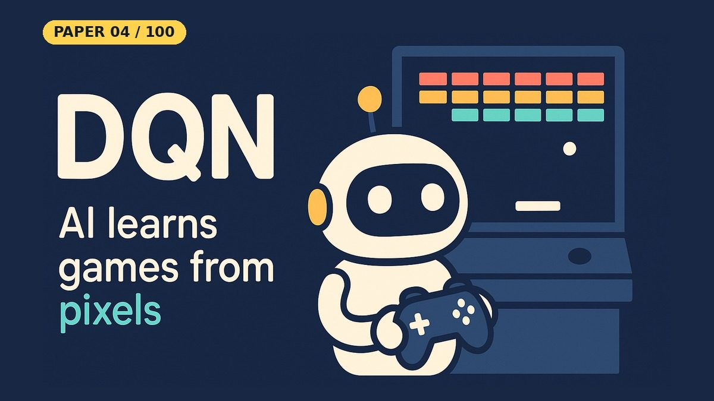

# Playing Atari with Deep Reinforcement Learning (DQN)

[](https://www.kaggle.com/code/nadymsazad/playing-atari-with-deep-reinforcement-learning)

- **Paper:** [Playing Atari with Deep Reinforcement Learning](https://arxiv.org/abs/1312.5602)
- **Authors:** Volodymyr Mnih, Koray Kavukcuoglu, David Silver, Alex Graves, Ioannis Antonoglou, Daan Wierstra, Martin Riedmiller
- **Lab, year:** DeepMind, 2013 (NIPS Deep Learning Workshop)
- **Video:** YouTube Short coming on 19 Oct 2026 on [Backprop Daily](https://www.youtube.com/@BackpropDaily)

## Summary

This paper introduced **Deep Q-Networks (DQN)**, the first deep learning model to successfully learn control policies directly from high-dimensional sensory input using reinforcement learning. The core innovation is combining a neural network function approximator with Q-learning, trained using a variant of stochastic gradient descent.

The key challenges addressed are: (1) training instability from correlated samples and non-stationary distributions — solved with **experience replay** (storing transitions in a replay buffer and sampling random minibatches to decorrelate updates), and (2) the moving target problem where the network bootstraps from its own rapidly changing estimates. In the 2013 paper the targets come from the previous iteration's parameters; the separate **target network** (a copy of the network updated only periodically, providing stable targets) was formalized in the 2015 Nature follow-up, and this notebook implements it too.

The authors applied DQN to seven Atari 2600 games using the same architecture and hyperparameters — raw pixel inputs, no game-specific tuning — and outperformed all prior RL approaches on six games and surpassed human expert performance on three. This paper launched the entire field of deep reinforcement learning, leading directly to DQN improvements (Double DQN, Dueling DQN, Prioritized Replay, Rainbow), AlphaGo, AlphaZero, and modern RL.

## What Problem Does It Solve

Imagine teaching a computer to play a video game **from scratch** — just by looking at the screen, like a human would. Before this paper, AI game-playing systems either needed the game's internal state (knowing exactly where every object is behind the scenes) or hand-crafted rules for each specific game. It's like having to peek at a chef's recipe book instead of learning to cook by tasting and adjusting.

The challenge was that old reinforcement learning methods (Q-learning) used a "lookup table" approach: for every possible situation, they stored a value. But video game screens have millions of possible pixel combinations — you can't make a table that big. And when people tried to use neural networks instead of tables, the training was terribly unstable: the network would learn, then unlearn, then spiral out of control.

Mnih et al. from DeepMind solved this with two clever tricks. First, **experience replay**: instead of learning from each moment as it happens (which gives you a stream of very similar, correlated experiences), the AI saves all its experiences in a big memory buffer and randomly samples from it — like reviewing flashcards in random order rather than reading a textbook front-to-back.

Second, a **target network** (made explicit in the team's 2015 Nature follow-up, and included in this notebook): the AI keeps a frozen copy of itself that it uses as a stable reference for "what should the target be?" — only updating this copy occasionally. It's like a student who checks their answers against a textbook that only gets reprinted every few weeks, rather than one that changes every time they turn a page.

The result was stunning: one single AI, with the same architecture and settings, learned to play seven different Atari games just from pixels — beating previous AI on six and even surpassing human experts on three. It was the first time a general-purpose game-playing AI worked at this level, and it kicked off the entire field of deep reinforcement learning.

## Core Idea

- **Q-learning with a deep network:** replace the Q-table with a convolutional network Q(s, a; θ) that reads raw pixels and outputs a Q-value for every action in a single forward pass.
- **Experience replay:** store transitions in a large replay memory and train on random minibatches drawn from it, breaking the correlation between consecutive frames and reusing each experience many times.
- **Bootstrapped targets:** regress Q(s, a; θ) toward r + γ max_a' Q(s', a'). Keeping these targets stable (later done with a separate, periodically copied target network) is what makes training converge.
- **One agent, many games:** the same architecture and hyperparameters are used across all seven Atari games, with no game-specific features.

## Key Method Details

### Q-Learning Refresher

Q-learning estimates the action-value function Q(s, a) — the expected cumulative future reward of taking action a in state s. The Bellman update is:

```
Q(s, a) ← Q(s, a) + α [r + γ max_a' Q(s', a') - Q(s, a)]
```

### Deep Q-Network

DQN replaces the Q-table with a neural network Q(s, a; θ) parameterized by θ. The loss function is:

```
L(θ) = E_{(s,a,r,s') ~ U(D)} [(y - Q(s, a; θ))²]
where y = r + γ max_a' Q(s', a'; θ⁻)   (target network θ⁻)
```

### Experience Replay

- Store transitions (s, a, r, s') in a replay buffer D of capacity N
- During training, sample random minibatches from D uniformly
- This breaks temporal correlations and smooths the data distribution
- The paper uses a replay buffer of 1,000,000 transitions

### Target Network

- Maintain a separate network Q(s, a; θ⁻) with parameters θ⁻
- θ⁻ is updated by copying θ every C steps (not every gradient step)
- This stabilizes training: the target y doesn't change with every update, preventing feedback loops
- C = 10,000 steps in the 2015 Nature version. The 2013 workshop paper computes targets with the previous iteration's parameters instead of a separate periodically copied network; the notebook follows the later, more stable recipe

### Training Algorithm (Algorithm 1)

As implemented in the notebook (the target-network steps come from the 2015 Nature version):

1. Initialize replay buffer D, Q-network with random weights θ, target network θ⁻ = θ
2. For each episode:
   a. Observe initial state s
   b. For each step:
      - With probability ε, select random action; otherwise select argmax_a Q(s, a; θ)
      - Execute action, observe reward r and next state s'
      - Store (s, a, r, s') in D
      - Sample random minibatch from D
      - Compute target y = r + γ max_a' Q(s', a'; θ⁻)
      - Update θ with gradient descent on (y - Q(s, a; θ))²
      - Every C steps, set θ⁻ = θ
      - Decay ε

### Architecture (Original)

- Input: 84×84×4 stacked frames (last 4 frames for motion information)
- 2 convolutional layers (16 filters 8×8 stride 4, 32 filters 4×4 stride 2) + 1 fully connected hidden layer (256 units); the 2015 Nature version uses 3 convolutional + 2 fully connected layers
- Output: Q-values for each action

### Simplifications in This Notebook

We implement DQN on **CartPole-v1** (a classic control task with a 4-number state and 2 actions) using an MLP instead of a CNN. This keeps the notebook CPU-runnable while keeping the core parts (experience replay, ε-greedy, the Q-learning target). The same algorithm scales to Atari by swapping the MLP for a CNN and using pixel inputs.

- MLP with 2 hidden layers of 128 units instead of the 2-conv + 1-FC CNN
- 600 episodes, Adam with learning rate 2.5e-4, batch size 64
- Replay buffer of 10,000 transitions instead of 1,000,000 frames
- Target network copied every 250 steps (from the 2015 Nature version; the 2013 paper has none)
- Huber (smooth L1) loss and gradient clipping at 10, instead of plain squared error
- ε decays by ×0.995 per episode (about 0.049 after 600 episodes) instead of 1 → 0.1 over a million frames

### What the Notebook Result Shows

The main run (seed 42) **learned CartPole slowly and did not solve it**. The 50-episode training average went from 18.4 (episode 50) to 164.6 (episode 600). With exploration turned off (ε = 0), the trained agent averaged **197.3 ± 7.2** over 20 episodes, 41.5% of the 475 "solved" threshold, and none of the 20 episodes reached the 500 cap. In the demo episode the pole never tilted past 7.8°, but the cart drifted to the edge of the track.

The notebook then asks what the paper's ideas buy, with a small ablation: the same agent, five seeds each, in three versions.

| Version | Mean of last-50 average, 5 seeds | Worst seed | Best seed |
|---|---|---|---|
| Full DQN | 269.9 | 58.7 | 457.5 |
| No target network | 9.6 | 9.4 | 9.7 |
| Tiny buffer (last 64 transitions) | 351.6 | 82.0 | 495.0 |

- **The target network is essential here.** Without it all five seeds stay at about 9.6 reward for all 600 episodes and never learn.
- **Run-to-run variance is huge.** The same full-DQN code finishes anywhere from 58.7 to 457.5 depending on the seed.
- **Replay did not show a benefit on CartPole.** The tiny-buffer version did at least as well on average, though with five seeds and this spread the difference is within noise. CartPole is simple enough that correlated minibatches are tolerable; the notebook does not test Atari.

The notebook also plots the value the network predicts at each step against the discounted return it actually collects. The network predicts about 100 (the value of surviving forever) throughout an episode that ends in failure after 207 steps, so it does not see the failure coming.

## Influence

- **Direct descendants**: Double DQN (2015), Dueling DQN (2015), Prioritized Experience Replay (2015), Rainbow (2017), Distributional RL (C51, QR-DQN)
- **DeepMind lineage**: Led directly to AlphaGo (2016), AlphaZero (2017), MuZero (2019), Agent57 (2020)
- **Atari benchmark**: Established the Atari 2600 / Arcade Learning Environment as the standard benchmark for deep RL
- **Human-level control**: DQN's successor, "Human-level control through deep reinforcement learning" (Nature 2015), achieved human-level performance on 49 Atari games — a landmark in AI
- **Industry impact**: Demonstrated that deep RL could learn complex control from raw sensory input, inspiring applications in robotics, autonomous driving, game AI, and recommendation systems
- **NIPS 2013**: Presented at the NIPS Deep Learning Workshop, 2013

---

## Resources

| File | Description |
|------|-------------|
| [README.md](README.md) | This overview — a 5-minute read covering the paper's summary, core idea, key method details, influence, and a plain-English explanation of the problem it solves |
| [solution.ipynb](https://nbviewer.org/github/nadeemcite/research-papers/blob/main/051_playing-atari-with-deep-reinforcement/solution.ipynb) | From-scratch PyTorch DQN on CartPole-v1 (MLP Q-network, replay buffer, target network, ε-greedy), with the training loop, plots, a greedy evaluation and a five-seed ablation |
| [CODE_ARCHITECTURE.md](CODE_ARCHITECTURE.md) | Section-by-section breakdown of the notebook — what each cell does, data flow, tensor shapes, and key design decisions |
| [TALK.md](TALK.md) | Press coverage, blog posts, Q&A (answers from the paper), citations, and common misconceptions about the paper |
