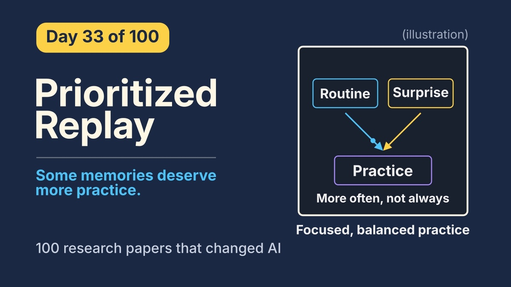

# Prioritized Experience Replay

- **Paper:** [Prioritized Experience Replay](https://arxiv.org/abs/1511.05952)
- **Authors:** Tom Schaul, John Quan, Ioannis Antonoglou, David Silver
- **Lab, year:** Google DeepMind, 2015 (ICLR 2016)
- **Video:** [Watch the YouTube Short](https://youtube.com/shorts/UXlMmgVosbU) on [Backprop Daily](https://www.youtube.com/@BackpropDaily)

## Summary

DQN learns from a "replay memory": it stores past experiences and trains on random samples of them. Before this paper, every stored experience had the same chance of being picked, no matter how useful it was.

Prioritized experience replay picks experiences more often when the agent got them most wrong, measured by the TD error (the gap between what the agent predicted and what actually happened). To keep learning unbiased, it scales down the updates from those over-sampled experiences with importance-sampling weights.

With DQN, it beat uniform replay on 41 of 49 Atari games, and combined with Double DQN it set a new state of the art in the paper.

## What Problem Does It Solve

Imagine studying for an exam with a big pile of flashcards. If you shuffle and draw at random, you keep seeing cards you already know and rarely see the few you keep getting wrong.

A uniform replay memory works the same way. Rare but important experiences, like the first time the agent reaches a reward, are replayed as rarely as boring ones.

Prioritized replay is like putting the cards you got wrong back near the top of the pile. The agent spends more of its training time on the experiences it still has the most to learn from.

## Core Idea

- **Priority from surprise:** each stored transition gets a priority from the size of its last TD error \|δ\|. New transitions get the highest priority, so every one is replayed at least once.
- **Stochastic prioritization:** transitions are sampled with probability P(i) = p_i^α / Σ_k p_k^α. With α = 0 this is uniform replay; larger α prioritizes more strongly, but every transition keeps some chance.
- **Two ways to set p_i:** proportional, p_i = \|δ_i\| + ε, or rank-based, p_i = 1 / rank(i).
- **Bias correction:** each update is scaled by an importance-sampling weight w_i = (N · P(i))^(−β), normalized so weights only scale updates down. β is annealed linearly to 1 by the end of training.

## Key Method Details

- **Data structures:** the proportional variant uses a "sum-tree", where each node holds the sum of its children, for O(log N) sampling and updates. The rank-based variant uses an array-based binary heap as an approximately sorted array (Appendix B.2.1).
- **Atari settings:** α = 0.6, β₀ = 0.4 for proportional and α = 0.7, β₀ = 0.5 for rank-based, found by a coarse grid search; the step size was reduced by a factor of 4.
- **Results:** added to DQN, prioritized replay improved the score on 41 of 49 games. Combined with Double DQN, the median normalized score rose from 111% to 128% with proportional prioritization (113% with rank-based), and learning was about twice as fast on aggregate (Section 4, Table 1).

### Simplifications in This Notebook

The notebook implements the sum-tree, proportional prioritization and importance-sampling weights from scratch in NumPy. It compares two DQN agents, one with uniform and one with prioritized replay, on a 6-cell 1D gridworld (one-hot states, 2 actions, +1 at the goal, −0.01 per step). Each uses a small MLP (two hidden layers of 64), learning rate 0.01, γ = 0.95, a buffer of 5,000, batches of 32 and 500 episodes. There is no Double DQN and no rank-based variant.

### What the Notebook Result Shows

Both agents learn the task, and prioritized replay gives no clear gain here. The 30-episode average reward first reached 0.5 after **52** episodes with uniform replay and **50** with prioritized replay. Over 500 episodes they reached the goal **476** and **479** times, with final 50-episode averages of **0.955** and **0.954**.

The mean \|TD error\| of the sampled batches stays below about 0.3 and is higher for prioritized replay, as expected, since it picks the high-error transitions. The 6-cell gridworld is simply too easy for prioritization to matter. An earlier version of this notebook had the gradient sign reversed, so its Q-values diverged; the numbers above come from the corrected code.

## Influence

OpenAlex lists about 4,540 citations ([4,541 when checked on 16 November 2026](https://openalex.org/W2201581102)). Prioritized replay is one of the six DQN extensions combined in [Rainbow](https://arxiv.org/abs/1710.02298), and OpenAI's Spinning Up lists the paper among its [key papers in deep RL](https://spinningup.openai.com/en/latest/spinningup/keypapers.html).

---

## Resources

| File | Description |
|------|-------------|
| [README.md](README.md) | This overview — a 5-minute read covering the paper's summary, core idea, key method details, influence, and a plain-English explanation of the problem it solves |
| [solution.ipynb](https://nbviewer.org/github/nadeemcite/research-papers/blob/main/054_prioritized-experience-replay/solution.ipynb) | From-scratch NumPy implementation of a sum-tree, prioritized replay and a small DQN, compared with uniform replay on a gridworld |
| [CODE_ARCHITECTURE.md](CODE_ARCHITECTURE.md) | Section-by-section breakdown of the notebook — what each cell does, data flow, tensor shapes, and key design decisions |
| [TALK.md](TALK.md) | Press coverage, Q&A (answers from the paper), citations, and common misconceptions about the paper |
