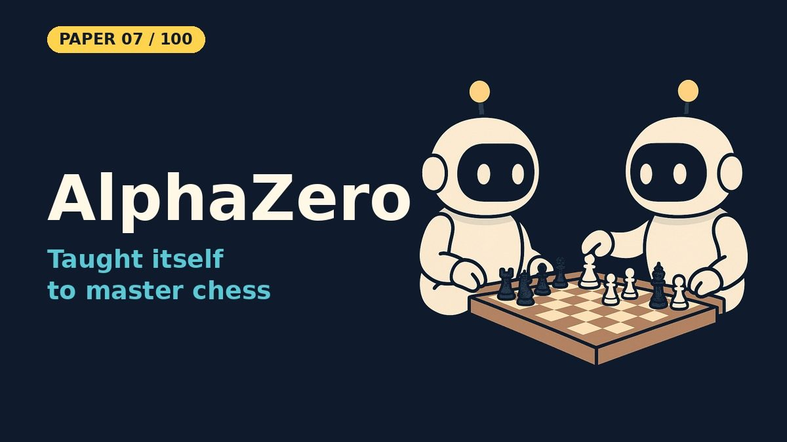

# Mastering Chess and Shogi by Self-Play with a General Reinforcement Learning Algorithm (AlphaZero)

- **Paper:** [Mastering Chess and Shogi by Self-Play with a General Reinforcement Learning Algorithm](https://arxiv.org/abs/1712.01815)
- **Authors:** David Silver, Thomas Hubert, Julian Schrittwieser, Ioannis Antonoglou, Matthew Lai, Arthur Guez, Marc Lanctot, Laurent Sifre, Dharshan Kumaran, Thore Graepel, Timothy Lillicrap, Karen Simonyan, Demis Hassabis
- **Lab, year:** DeepMind, 2017 (Science, 2018)
- **Video:** [Watch the YouTube Short](https://youtube.com/shorts/Jc-9wO_qVKM) on [Backprop Daily](https://www.youtube.com/@BackpropDaily)

## Summary

AlphaZero is a single, generic reinforcement learning algorithm that achieves superhuman performance in chess, shogi, and Go — starting from random play with no domain knowledge except the game rules. It generalises the earlier AlphaGo Zero approach: a deep neural network (p, v) = fθ(s) takes a board position s and outputs a policy vector p (move probabilities) and a scalar value v (expected outcome), replacing the handcrafted evaluation functions and move-ordering heuristics used by traditional engines. Instead of alpha-beta search, AlphaZero uses Monte-Carlo Tree Search (MCTS) guided by the neural network: each simulation selects moves with low visit count, high prior probability, and high value. The network is trained entirely by self-play reinforcement learning — games are played by MCTS using the latest network, terminal positions are scored as −1/0/+1, and the loss function combines mean-squared error on the value prediction and cross-entropy on the policy prediction against the MCTS visit-count distribution.

Key differences from AlphaGo Zero: (1) AlphaZero estimates expected outcome including draws, not just binary win/loss; (2) it does not use symmetries (chess/shogi are asymmetric); (3) it maintains a single network updated continually rather than checkpoint-based best-player evaluation; (4) it reuses the same hyperparameters across all games without per-game tuning. Starting from random initialization, AlphaZero surpassed Stockfish in chess after 4 hours, Elmo in shogi after 2 hours, and AlphaGo Lee in Go after 8 hours — all using 5,000 first-generation TPUs for self-play generation and 64 second-generation TPUs for training.

## What Problem Does It Solve

Imagine you want to build a robot that can play any board game — chess, checkers, Go — but instead of programming it with centuries of human strategy knowledge, you just teach it the rules and let it play against itself millions of times until it figures out the best moves on its own. That's the problem AlphaZero solves. Before AlphaZero, the best chess programs (like Stockfish) were essentially giant lookup tables of human-designed rules: "a knight is worth 3 points," "control the center," "don't hang your queen." Engineers spent decades hand-tuning these rules. AlphaZero throws all of that away. You give it the rules of chess, it plays against itself, and within four hours it beats Stockfish, the strongest conventional chess engine it was tested against. It even rediscovered famous human openings like the Sicilian Defense and the English Opening — purely by trial and error. The big idea is that a single, simple algorithm — "search with a neural network, play against yourself, learn from the results" — can master any game without any human expertise, which is a step toward general AI.

## Core Idea

- **One algorithm, several games:** the same algorithm, network architecture and hyperparameters learn chess, shogi and Go, given nothing but the rules.
- **Learned evaluation instead of handcrafted heuristics:** a single deep network (p, v) = fθ(s) predicts move probabilities and the expected game outcome from a board position.
- **Network-guided MCTS instead of alpha-beta search:** Monte-Carlo Tree Search uses the network's move priors and value estimates to focus the search on promising lines.
- **Pure self-play reinforcement learning:** starting from random weights, the system improves only by playing against itself and training the network to match the MCTS move distribution and the final game result.

## Key Method Details

- **MCTS with neural network guidance:** each node stores visit count N, total value W, prior probability P, and Q = W/N. Selection uses the PUCT formula: a = argmax(Q(s,a) + c_puct · P(s,a) · √N(s) / (1 + N(s,a))). Expansion adds a leaf, evaluated by the network to get (p, v). Backup propagates v up the path.
- **Self-play data generation:** MCTS runs 800 simulations per move. The search returns a policy π proportional to visit counts at the root (with Dirichlet noise for exploration). Moves are sampled from π (or temperature-annealed).
- **Training loss:** l = (z − v)² − πᵀ log p + c‖θ‖², combining MSE value loss, cross-entropy policy loss, and L2 regularization.
- **Continual updates:** the network is updated continuously from self-play data, unlike AlphaGo Zero's iteration-based best-player checkpointing.

### Simplifications in This Notebook

- Connect Four (6×7 board, 7 moves) instead of chess, shogi and Go
- A 2-layer CNN with policy and value heads instead of a deep residual network
- 100 MCTS simulations per move instead of 800
- 3 training iterations of 20 self-play games each, a 500-position replay buffer, Adam with lr 0.001

### What the Notebook Result Shows

The run is a working demo of the AlphaZero loop, not a strong player. Over 3 iterations the value loss fell from **0.7404** to **0.5541**, while the policy loss barely moved (**1.9579** → **1.8819**). Against a random player the network with MCTS won **95.0%**, **95.0%** and then **100.0%** of 20 games. MCTS alone already beats random moves most of the time, so this mainly shows that the search works. In a sample position, MCTS spent 102 of 200 simulations on the center column.

## Influence

AlphaZero is one of the most influential AI papers of the decade:
- **Generalized self-play learning:** proved that a single algorithm can master multiple games without domain-specific engineering, a milestone toward general-purpose AI.
- **Leela Chess Zero:** the open-source community project Leela Chess Zero (lc0) directly implements AlphaZero's approach and competed at the top level against Stockfish in TCEC championships.
- **MuZero (2019):** DeepMind's follow-up extended AlphaZero to learn the game rules themselves (no rules given), playing Atari, chess, shogi, and Go with a single system.
- **MCTS + neural networks in RL:** MuZero and Leela Chess Zero continued the approach of pairing tree search with a neural network.
- **Science (2018):** the final version was published in Science.

---

## Resources

| File | Description |
|------|-------------|
| [README.md](README.md) | This overview — a 5-minute read covering the paper's summary, core idea, key method details, influence, and a plain-English explanation of the problem it solves |
| [solution.ipynb](https://nbviewer.org/github/nadeemcite/research-papers/blob/main/061_alphazero-mastering-chess-and-shogi-by/solution.ipynb) | Complete from-scratch PyTorch implementation of the paper's architecture, with training loops, visualizations, and worked examples |
| [CODE_ARCHITECTURE.md](CODE_ARCHITECTURE.md) | Section-by-section breakdown of the notebook — what each cell does, data flow, tensor shapes, and key design decisions |
| [TALK.md](TALK.md) | Press coverage, blog posts, Q&A (answers from the paper and linked sources), citations, and common misconceptions about the paper |
