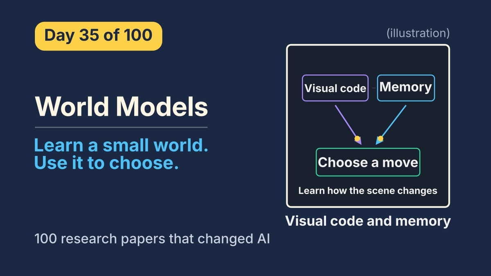

# World Models

- **Paper:** [World Models](https://arxiv.org/abs/1803.10122)
- **Authors:** David Ha, Jürgen Schmidhuber
- **Lab, year:** Google Brain / NNAISENSE, 2018
- **Video:** [Watch the YouTube Short](https://youtube.com/shorts/fVALpy8HLAs) on [Backprop Daily](https://www.youtube.com/@BackpropDaily)

## Summary

This paper builds an agent from three parts. A vision model squeezes each game frame into a small code, a memory model learns to predict what code comes next, and a tiny controller picks actions from what the other two know.

Because the memory model can predict the future, it can act as a "dream" version of the game. In the VizDoom experiment, the authors trained the controller entirely inside this dream and then moved it into the real game, where it still worked. On CarRacing, the controller was trained in the real environment using the world model's features, and it was the first known solution of the task.

The work also appeared at NeurIPS 2018 as a separate paper, "Recurrent World Models Facilitate Policy Evolution".

## What Problem Does It Solve

Think of a baseball batter. The ball arrives too fast to think about, so the batter swings based on a picture in their head of where the ball will be.

Reinforcement learning agents usually learn straight from raw pixels, which is hard and slow. This paper gives the agent its own small model of the world first. The model compresses what the agent sees and predicts what happens next, so the part that chooses actions can be tiny.

And if the model is good enough, the agent can practise inside it, like rehearsing in your head, instead of always using the real environment.

## Core Idea

- **V (vision):** a variational autoencoder compresses each 64×64 frame into a small latent vector z.
- **M (memory):** an MDN-RNN, an LSTM whose output is a mixture of Gaussians, predicts the distribution of the next z from the current z, the action and its hidden state h.
- **C (controller):** a single linear layer maps [z, h] to the action. It is kept tiny on purpose, so it can be trained with an evolution strategy instead of gradients.
- **Dreams:** M can be sampled step by step to generate whole imagined episodes, and C can be trained inside them.

## Key Method Details

- **Training order:** collect 10,000 rollouts with a random policy, train V on the frames, train M on the encoded sequences, then train C with CMA-ES (Sections 3.2 and 4.2).
- **CarRacing:** z has 32 dimensions and C has 867 parameters. The full model scored 906 ± 21 over 100 trials; a controller that saw only z scored 632 ± 251 (Section 3.3, Table 1). C was trained in the real environment.
- **VizDoom: Take Cover:** M also predicts whether the agent dies, so it forms a complete environment. C trained only inside it and, with temperature τ = 1.15, survived 1092 ± 556 steps in the real game, against 210 ± 108 for a random policy (Sections 4.1–4.4, Table 2).
- **Cheating the world model:** the controller can exploit M's mistakes. At τ = 0.1 it scored 2086 in the dream but only 193 in the real game; a higher τ makes the dream harder to exploit (Section 4.5, Table 2).

### Simplifications in This Notebook

The notebook builds V, M and C in PyTorch on a toy 2D task, PointMassNav: move a dot to a target cross in 64×64 grayscale frames. V has a 32-dim latent; M is an LSTM with 128 units and 5 mixture components, and here it also predicts the reward, since the toy task needs a reward signal in the dream. V and M are trained on only 50 random rollouts. C is trained inside the dream (τ = 1.15) with a simple rank-based evolution strategy instead of CMA-ES, then tested in the real task against two random baselines.

### What the Notebook Result Shows

**The dream-trained controller lost to random in the real task.** Over 20 test episodes its mean reward was **−133.5**, against **−111.8** for a randomly initialised controller and **−101.6** for random actions; no policy reached the target. It simply drives towards one corner.

The controller did improve inside the dream (predicted return from −47.6 to −33.9), so this is the "cheating the world model" problem from Section 4.5. The root cause is V: a linear probe recovers the agent and target positions from z with R² of only 0.09–0.17, so the dream cannot know where the target is. An earlier version of this notebook claimed the controller beat a random baseline, which its own outputs contradicted.

## Influence

OpenAlex lists about 2,300 citations for the arXiv paper ([2,315 when checked on 18 November 2026](https://openalex.org/W2795843265)) and about 1,180 for the NeurIPS 2018 version ([1,177 when checked on 18 November 2026](https://openalex.org/W2890208753)). OpenAI's Spinning Up lists the NeurIPS version among its [key papers in deep RL](https://spinningup.openai.com/en/latest/spinningup/keypapers.html). Later agents that learn behaviours inside a learned world model include [Dreamer](https://arxiv.org/abs/1912.01603) and [DreamerV3](https://arxiv.org/abs/2301.04104).

---

## Resources

| File | Description |
|------|-------------|
| [README.md](README.md) | This overview — a 5-minute read covering the paper's summary, core idea, key method details, influence, and a plain-English explanation of the problem it solves |
| [solution.ipynb](https://nbviewer.org/github/nadeemcite/research-papers/blob/main/062_world-models/solution.ipynb) | From-scratch PyTorch VAE, MDN-RNN and linear controller trained in a dream on a toy navigation task, with an honest transfer test |
| [CODE_ARCHITECTURE.md](CODE_ARCHITECTURE.md) | Section-by-section breakdown of the notebook — what each cell does, data flow, tensor shapes, and key design decisions |
| [TALK.md](TALK.md) | Press coverage, Q&A (answers from the paper), citations, and common misconceptions about the paper |
