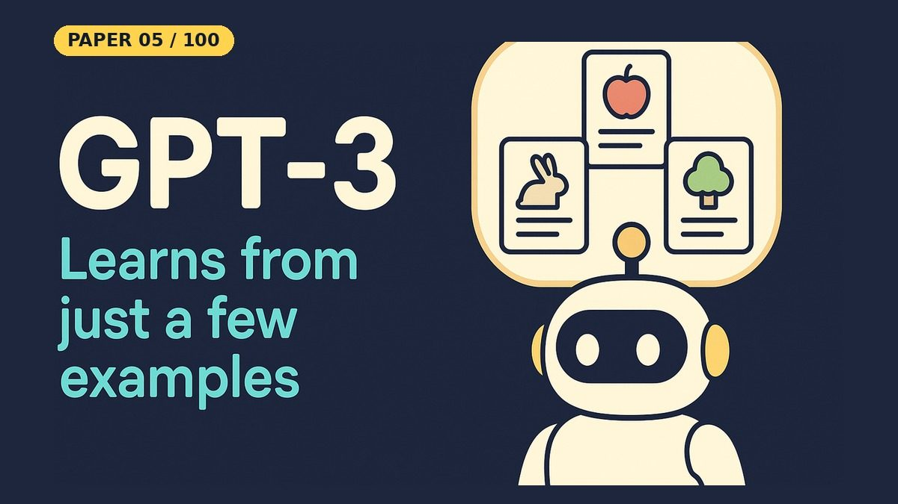

# Language Models are Few-Shot Learners (GPT-3)

- **Paper:** [Language Models are Few-Shot Learners](https://arxiv.org/abs/2005.14165)
- **Authors:** Tom B. Brown, Benjamin Mann, Nick Ryder, Melanie Subbiah, Jared Kaplan, Prafulla Dhariwal, Arvind Neelakantan, Pranav Shyam, Girish Sastry, Amanda Askell, Sandhini Agarwal, Ariel Herbert-Voss, Gretchen Krueger, Tom Henighan, Rewon Child, Aditya Ramesh, Daniel M. Ziegler, Jeffrey Wu, Clemens Winter, Christopher Hesse, Mark Chen, Eric Sigler, Mateusz Litwin, Scott Gray, Benjamin Chess, Jack Clark, Christopher Berner, Sam McCandlish, Alec Radford, Ilya Sutskever, Dario Amodei
- **Lab, year:** OpenAI, 2020
- **Video:** [Watch the YouTube Short](https://youtube.com/shorts/N6kmRrwHFL8) on [Backprop Daily](https://www.youtube.com/@BackpropDaily)

## Summary

GPT-3 demonstrated that scaling up autoregressive language models to 175 billion parameters enables strong task-agnostic, few-shot performance without any gradient updates or fine-tuning. Tasks and few-shot demonstrations are specified purely via text interaction with the model. GPT-3 achieves competitive results on translation, question-answering, cloze tasks, arithmetic, and novel-word usage, sometimes matching prior state-of-the-art fine-tuning approaches. The paper introduces three evaluation paradigms — **zero-shot** (task description only), **one-shot** (one example), and **few-shot** (K examples in the prompt) — and shows that performance consistently improves with model scale and number of in-context examples.

## What Problem Does It Solve

Imagine you're learning a new board game. If someone just tells you the rules, that's like *zero-shot* — you might get it right, but you'll make mistakes. If they show you one example move, that's *one-shot* — a bit better. If they walk you through several rounds first, that's *few-shot* — you'll play much more confidently.

Before GPT-3, AI systems needed hundreds or thousands of practice examples to learn a new task (like having to play 500 games before understanding the rules). GPT-3 showed that a big enough AI, having already read tons of text, can learn new tasks from just a handful of examples — the same way you pick up a new game after watching a few rounds. This paper proved that simply making language models *bigger* lets them learn this way, no special training required.

## Core Idea

The key insight is that large language models, trained on enough data, develop a *meta-learning* capability through in-context learning. Instead of updating weights for a new task, the model conditions on a prompt containing a task description and a few input-output examples, then generates the answer for a new input. This is essentially pattern completion: the model uses its pretrained knowledge to continue the pattern established by the examples.

The paper evaluates on dozens of NLP tasks: translation, QA, cloze, arithmetic, word unscrambling, novel word usage, news article generation, and SAT analogies. A central finding is the **scaling relationship** — both model size and number of in-context examples drive better performance, with the largest model (175B) showing the steepest improvement.

## Key Method Details

1. **In-context learning protocol:** The prompt is constructed as `task_description + K examples + query`, where each example is `input → output`. The model generates the output for the query via next-token prediction.
2. **Few-shot scaling:** Accuracy generally improves as K, the number of examples in the prompt, grows. In the few-shot setting the paper uses as many examples as fit in the 2,048-token context window (typically 10 to 100).
3. **Model scaling:** Larger models use in-context examples more effectively — the gap between zero-shot and few-shot widens with scale.
4. **No gradient updates:** The model weights are frozen; all task knowledge is accessed through the prompt.

### Simplifications in This Notebook

- GPT-2 small (124M parameters, pretrained, frozen) instead of GPT-3 (175B); no training at all
- One toy task: 50 hand-written sentences for binary sentiment, split into a 20-sentence example pool and a 30-sentence test set
- K = 0, 1, 2, 4, 8 and 16 examples; 3 random draws of examples per K
- The label is chosen by comparing the next-token scores of " positive" and " negative", not by free text generation

### What the Notebook Result Shows

Accuracy on the 30 test sentences rose from **50.0%** with no examples (K=0) to **56.7%** (K=1), **60.0%** (K=2), **70.0%** (K=4), **71.1%** (K=8) and **76.7%** (K=16). So more examples in the prompt helped even this small model. Keep the caveats in mind: the test set has only 30 sentences (17 of them negative, so always saying "negative" would already score 56.7%), and single draws vary a lot (from 70.0% to 86.7% at K=16). This shows the in-context effect at toy scale; it does not reproduce GPT-3's numbers.

## Influence

GPT-3 popularized the in-context learning paradigm and prompt engineering, directly leading to GPT-3.5/4, ChatGPT, and the modern LLM era. It showed that scale alone can unlock emergent capabilities, influencing the entire trajectory of large language model development. It is one of the most influential AI papers of the decade.

---

## Resources

| File | Description |
|------|-------------|
| [README.md](README.md) | This overview — a 5-minute read covering the paper's summary, core idea, key method details, influence, and a plain-English explanation of the problem it solves |
| [solution.ipynb](https://nbviewer.org/github/nadeemcite/research-papers/blob/main/080_language-models-few-shot-learners-gpt3/solution.ipynb) | In-context learning demo with pretrained GPT-2 (no training): zero-, one- and few-shot sentiment prompts, an accuracy-vs-K sweep and plot |
| [CODE_ARCHITECTURE.md](CODE_ARCHITECTURE.md) | Section-by-section breakdown of the notebook — what each cell does, data flow, tensor shapes, and key design decisions |
| [TALK.md](TALK.md) | Press coverage, blog posts, Q&A (answers from the paper), citations, and common misconceptions about the paper |
