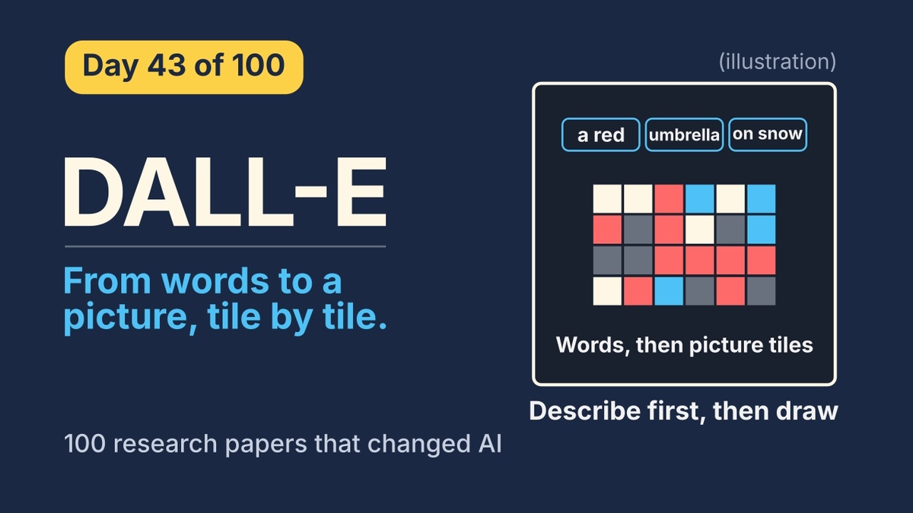

# Zero-Shot Text-to-Image Generation (DALL-E)

- **Paper:** [Zero-Shot Text-to-Image Generation](https://arxiv.org/abs/2102.12092)
- **Authors:** Aditya Ramesh, Mikhail Pavlov, Gabriel Goh, Scott Gray, Chelsea Voss, Alec Radford, Mark Chen, Ilya Sutskever
- **Lab, year:** OpenAI, 2021 (ICML 2021)
- **Video:** YouTube Short coming on 27 Nov 2026 on [Backprop Daily](https://www.youtube.com/@BackpropDaily)

## Summary

DALL-E makes a picture from a sentence. It treats this as next-token prediction: one transformer reads the caption's text tokens and then writes the image's tokens, one after another, as a single stream.

To make an image short enough for this, a discrete VAE (dVAE) first turns each 256×256 image into a 32×32 grid of 1024 image tokens, each one of 8192 codes. The transformer has 12 billion parameters and was trained on 250 million text-image pairs from the internet.

Without being trained on MS-COCO captions, its samples were preferred by human judges over those of DF-GAN, a model trained on MS-COCO, 90% of the time for realism and 93% of the time for matching the caption.

## What Problem Does It Solve

Imagine teaching a child to draw by showing them millions of pictures, each with a short description underneath. After a while you can say "a hedgehog in a Christmas sweater" and they draw it, even though no picture they saw had exactly that.

Before DALL-E, most text-to-image models were trained on one fixed dataset, such as birds or everyday scenes, with special architectures and extra losses. DALL-E asks whether a simple, general method works if it is big enough and sees enough data. Words and pictures both become tokens, and the model just learns to continue the stream. Tested "zero-shot", on captions from datasets it was never trained on, it was competitive with the specialised models.

## Core Idea

- **Two stages:** first learn a visual codebook (the dVAE), then learn a prior over text and image tokens (the transformer). Together they maximise a lower bound on the likelihood of images and captions (Section 2, Eq. 1).
- **Stage 1, the dVAE:** the encoder outputs 8192 logits for each of the 32×32 grid positions. Instead of the straight-through estimator used by VQ-VAE, it is trained with the **gumbel-softmax relaxation**, with the temperature annealed to 1/16 and a KL term towards a uniform prior over the codes (Section 2.1).
- **Stage 2, the transformer:** up to 256 BPE text tokens (vocabulary 16,384) are followed by the 1024 image tokens (vocabulary 8192) and modelled autoregressively by a 12-billion-parameter sparse transformer. Each image token can attend to all text tokens (Section 2.2).
- **Generation and reranking:** many images are sampled for a caption, and a pretrained contrastive model (CLIP) ranks them by how well they match it (Section 2.6).

## Key Method Details

- **dVAE training:** the KL weight β rises from 0 to 6.6, which the authors found gives better codebook use and a lower final reconstruction error. The encoder ends, and the decoder starts, with 1×1 convolutions. The pixels use a logit-Laplace likelihood (Section 2.1, Appendix A).
- **Image tokens for stage 2:** the argmax of the dVAE encoder's logits, with no gumbel noise (Section 2.2).
- **Attention:** a standard causal mask for text-to-text attention, and row, column or convolutional masks for image-to-image attention, over 64 self-attention layers (Section 2.2).
- **Loss weights:** the text and image cross-entropies are each averaged, then weighted 1/8 and 7/8, because image modelling is the main goal (Section 2.2).
- **Data:** 250 million text-image pairs, including Conceptual Captions and a filtered subset of YFCC100M (Section 2.3).
- **Training at scale:** 16-bit mixed precision with per-resblock gradient scaling, and PowerSGD gradient compression for distributed training (Sections 2.4 and 2.5).
- **Results:** on MS-COCO, human judges preferred its samples to DF-GAN's 93% of the time for matching the caption and 90% for realism. Its FID was within 2 points of the best prior method, and about 6 points better after a slight blur. On the specialised CUB birds dataset it was much worse, with a gap of nearly 40 FID points (Section 3.1).
- **Qualitative findings:** it can combine unusual concepts ("a tapir made of accordion"), render text, and do simple image-to-image translation guided by a caption, but only with limited reliability (Section 3.3).

### Simplifications in This Notebook

The notebook builds both stages from scratch in PyTorch on synthetic 32×32 images of one coloured shape each, with captions like "a red circle" (6 colours × 3 shapes). The dVAE turns an image into 8×8 = 64 tokens from 128 codes and is trained with the gumbel-softmax relaxation, τ annealed to 1/16 and a KL term to a uniform prior.

A 3.2M-parameter transformer models a 4-token caption plus the 64 image tokens, with text and image losses weighted 1/8 and 7/8. Three combinations (red square, blue triangle, green circle) are left out of all training, so their captions are a real zero-shot test. A colour rule and a small shape classifier score the generated images. There is no BPE, no sparse attention and no CLIP reranking.

### What the Notebook Result Shows

The dVAE used 123 of its 128 codes and reconstructed test images with an error of **0.0051** per pixel. The shapes and colours stay recognisable, with soft edges. In test runs with a much weaker KL weight, every grid cell collapsed onto a single code, which fits the paper's remark that a large KL weight helps codebook use.

For captions seen in training, **92.1%** of generated images had the right colour and shape. For the three held-out captions it was **53.1%**, far above the 5.6% expected by chance but well below the seen captions. Green circles worked best (68.8%). Red squares often came out as red circles, and blue triangles as purple triangles. The checker itself reads only 87.5% of reconstructions of held-out images correctly, so part of the gap may be blur rather than the transformer.

An earlier version of this notebook used a VQ-VAE-style model whose loss rose during training, so its images were noise. Its "zero-shot" captions had all been in the training data.

## Influence

OpenAlex lists about 6,700 citations ([6,685 when checked on 26 November 2026](https://openalex.org/W3129576130)). OpenAI released the [dVAE code](https://github.com/openai/DALL-E) used in the paper, and announced the model together with [CLIP](https://openai.com/index/clip/), the contrastive model used for reranking. OpenAI's follow-up [DALL·E 2](https://arxiv.org/abs/2204.06125) (Ramesh et al., 2022) generates images from CLIP image embeddings and compares its MS-COCO FID with DALL-E's, and Google's [Parti](https://arxiv.org/abs/2206.10789) (Yu et al., 2022) is, like DALL-E, a two-stage model that generates image tokens and reranks its samples with a contrastive model.

---

## Resources

| File | Description |
|------|-------------|
| [README.md](README.md) | This overview — a 5-minute read covering the paper's summary, core idea, key method details, influence, and a plain-English explanation of the problem it solves |
| [solution.ipynb](https://nbviewer.org/github/nadeemcite/research-papers/blob/main/083_zero-shot-text-to-image-generation-dall-e/solution.ipynb) | A tiny from-scratch DALL-E in PyTorch: a gumbel-softmax dVAE and a text-image transformer on synthetic coloured shapes, with a zero-shot test on held-out colour-shape combinations |
| [CODE_ARCHITECTURE.md](CODE_ARCHITECTURE.md) | Section-by-section breakdown of the notebook — what each cell does, data flow, tensor shapes, and key design decisions |
| [TALK.md](TALK.md) | Press coverage, Q&A (answers from the paper), citations, and common misconceptions about the paper |
