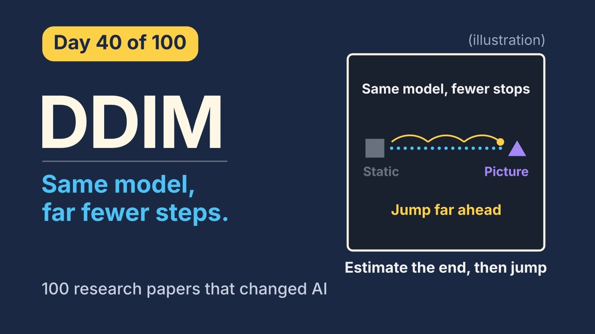

# Denoising Diffusion Implicit Models (DDIM)

- **Paper:** [Denoising Diffusion Implicit Models](https://arxiv.org/abs/2010.02502)
- **Authors:** Jiaming Song, Chenlin Meng, Stefano Ermon
- **Lab, year:** Stanford University, 2020 (ICLR 2021)
- **Video:** [Watch the YouTube Short](https://youtube.com/shorts/d6eC8fEv1yM) on [Backprop Daily](https://www.youtube.com/@BackpropDaily)

## Summary

Diffusion models such as DDPM make an image by removing noise step by step, often 1000 steps for a single picture. That makes them slow.

DDIM keeps the same trained network but changes how it samples. It can skip most of the steps, and with its setting η = 0 it removes no noise at random, so the same starting noise always gives the same image.

The paper reports high-quality samples 10× to 50× faster in wall-clock time than DDPM. Because sampling is deterministic, the starting noise also works like a code for the image: you can interpolate between two codes, or encode a real image into a code and decode it back.

## What Problem Does It Solve

Imagine a recipe with 1000 tiny steps: add a pinch, stir once, add another pinch. The cake turns out great, but it takes forever. DDPM is like that: to make one picture it must take all 1000 small denoising steps, in order.

DDIM shows that you can follow the same recipe in big jumps, maybe 50 steps instead of 1000, without retraining the cook. Each jump first guesses what the finished cake looks like, then moves the batter part of the way there. You get nearly the same cake in a fraction of the time, and the same ingredients always give the same cake.

## Core Idea

- **Same training, new sampler:** the DDPM objective only depends on the noise level at each step, q(x_t \| x_0). DDIM builds non-Markovian forward processes with the same marginals, so a model trained as a DDPM can be used as it is (Sections 3 and 4.1).
- **Predict, then step:** each step predicts the clean image x̂_0 from the noise estimate, then moves to the next noise level along the "direction pointing to x_t", with an optional random term σ_t (Eq. 12).
- **η controls randomness:** σ_t is set by a parameter η; η = 1 gives DDPM and η = 0 gives DDIM, a deterministic process (Eq. 16).
- **Skip steps:** the process can run on a short sub-sequence of the timesteps, for example 50 of 1000 (Section 4.2).

## Key Method Details

- **Accelerated sampling:** samples are drawn along a sub-sequence τ of length S; the paper uses the same trained models with T = 1000 and only changes τ and η (Sections 4.2 and 5).
- **Results:** on CIFAR10, DDIM (η = 0) reached FID 13.36 with 10 steps, 4.67 with 50 and 4.04 with 1000; DDPM (η = 1) got 41.07 with 10 steps and 8.01 with 50 (Section 5.1, Table 1).
- **Consistency:** with η = 0, samples from the same x_T with different numbers of steps share most high-level features (Section 5.2).
- **ODE view and encoding:** the DDIM update is like an Euler step of an ODE, so it can be run in reverse to encode x_0 into x_T (Section 4.3). On CIFAR-10 the reconstruction error fell from 0.014 with 10 steps to 0.0001 with 500 steps (Section 5.4, Table 2).

### Simplifications in This Notebook

The notebook trains a small U-Net (2.0M parameters, attention at 16×16) with the DDPM objective on all 60,000 FashionMNIST images resized to 32×32, with T = 1000, for 20 epochs, keeping an EMA copy of the weights. It then compares DDIM with 50 steps against DDPM with all 1000 steps, and tests consistency, interpolation, the effect of η, and DDIM encoding and decoding of real images. Quality is judged from sample grids and simple statistics, not FID.

### What the Notebook Result Shows

Training worked: the loss fell from **0.0696** to **0.0250**, and both samplers produce recognisable clothing. In the saved run, DDIM with 50 steps took **1.53 s** against **30.37 s** for DDPM with 1000 steps, a measured **19.8× speed-up**.

DDIM's consistency shows clearly: the same x_T decoded with 10 to 1000 steps gives the same item, with a mean squared difference to the 1000-step image of 0.0015 at 10 steps and under 0.0001 at 100 steps. Encoding real images with DDIM and decoding them back gave a reconstruction error of **0.0037** with 50 steps and **0.0003** with 200 steps (pixels in [0, 1]). An earlier version of this notebook trained for only 3 epochs with T = 100 and a broken attention layer, and its samples were pure noise.

## Influence

OpenAlex lists about 11,200 citations ([11,182 when checked on 23 November 2026](https://openalex.org/W3092442149)). Later work kept using and analysing its sampler: [DPM-Solver](https://arxiv.org/abs/2206.00927) shows that the DDIM update is the first-order case of its ODE solver (its Section 4.1, "DDIM as DPM-Solver-1"), [EDM](https://arxiv.org/abs/2206.00364) compares against DDIM, and [Latent Diffusion](https://arxiv.org/abs/2112.10752) generates its samples with the DDIM sampler.

---

## Resources

| File | Description |
|------|-------------|
| [README.md](README.md) | This overview — a 5-minute read covering the paper's summary, core idea, key method details, influence, and a plain-English explanation of the problem it solves |
| [solution.ipynb](https://nbviewer.org/github/nadeemcite/research-papers/blob/main/085_denoising-diffusion-implicit-models/solution.ipynb) | From-scratch PyTorch DDIM: a DDPM-trained U-Net on FashionMNIST, 50-step DDIM vs 1000-step DDPM, consistency, interpolation, η and encoding |
| [CODE_ARCHITECTURE.md](CODE_ARCHITECTURE.md) | Section-by-section breakdown of the notebook — what each cell does, data flow, tensor shapes, and key design decisions |
| [TALK.md](TALK.md) | Press coverage, Q&A (answers from the paper), citations, and common misconceptions about the paper |
