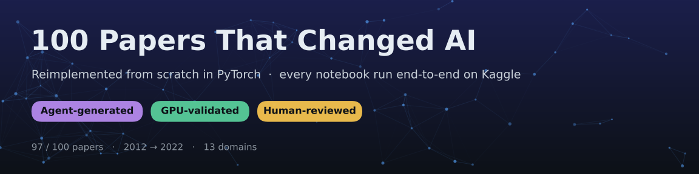
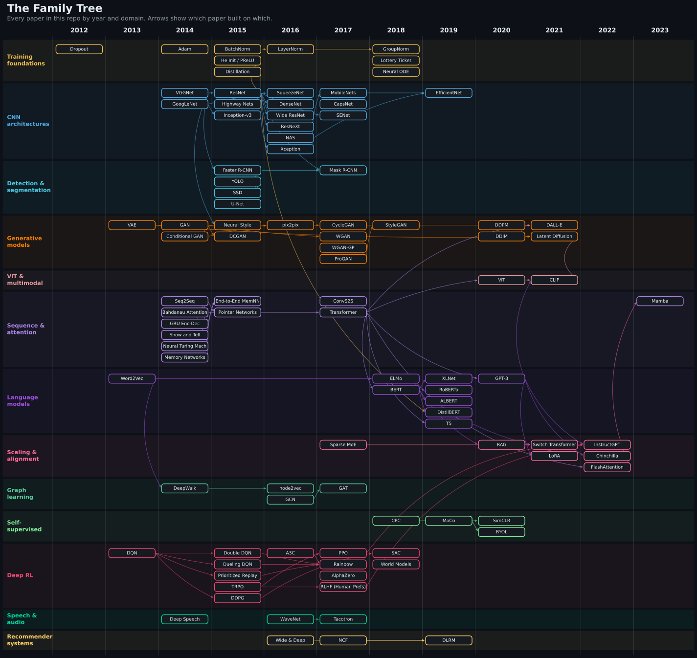

  
  
  
  

**100 of the 100 papers that shaped modern AI**, from Dropout (2012) to Mamba (2023), each turned into a small, runnable, from-scratch PyTorch reimplementation with a plain-English explainer. Every notebook in this repo was **executed top to bottom on Kaggle** and is published with its real outputs, so you can open it, see it work, and fork it on a free GPU.

## How it's made: agent-generated, GPU-validated, human-reviewed

This repo is also an experiment in what AI agents can build when the bar is *"it actually runs."*

1. **Curated list:** I picked 100 landmark papers and wrote, for each one, a spec of what its notebook should demonstrate.
2. **Agent-generated:** an AI agent reads the paper, writes the from-scratch implementation, and drafts the explainer docs.
3. **GPU-validated:** every notebook is pushed to Kaggle and run end-to-end, on a T4 GPU or on CPU for the small ones. A notebook ships only if every cell runs with zero errors, and the executed version, with its outputs, is what gets committed.
4. **Human-reviewed:** I review the code, results and claims before publishing, and re-run or rewrite the notebooks whose results don't hold up.

> **Scaled down on purpose.** These are teaching-sized reproductions: small models, synthetic or small datasets, minutes of training instead of days. They show *how* each idea works and reproduce the qualitative effect, not the paper's headline numbers. Each `CODE_ARCHITECTURE.md` lists the simplifications made.

## The family tree

## What's in each folder

| File | What it gives you |
|---|---|
| `README.md` | A 5-minute read: summary, core idea, key method details, influence, and the problem explained like you're 10 |
| `solution.ipynb` | The from-scratch implementation, executed on Kaggle with all outputs |
| `CODE_ARCHITECTURE.md` | A guided walkthrough of the notebook: data flow, tensor shapes, and simplifications vs. the paper |
| `TALK.md` | Coverage, interview-style Q&A, common misconceptions, and citations |

## Papers by domain

[Training Foundations](#training-foundations) · [Convolutional Architectures](#convolutional-architectures) · [Detection & Segmentation](#detection--segmentation) · [Generative Models: VAEs, GANs, Diffusion](#generative-models-vaes-gans-diffusion) · [Vision Transformers & Multimodal](#vision-transformers--multimodal) · [Sequence Models, Attention & Memory](#sequence-models-attention--memory) · [Pretrained Language Models](#pretrained-language-models) · [Scaling, Efficiency & Alignment](#scaling-efficiency--alignment) · [Graph Representation Learning](#graph-representation-learning) · [Self-Supervised Learning](#self-supervised-learning) · [Deep Reinforcement Learning](#deep-reinforcement-learning) · [Speech & Audio](#speech--audio) · [Recommender Systems](#recommender-systems)

### Training Foundations

| # | Year | Paper | Run it |
|---|---|---|---|
| 002 | 2012 | [Dropout — Improving Neural Networks by Preventing Co-adaptation of Feature Detectors](002_dropout-improving-neural-networks-by-preventing/) |  |
| 003 | 2014 | [Adam — A Method for Stochastic Optimization](003_adam-a-method-for-stochastic/) |  |
| 006 | 2015 | [Batch Normalization](006_batch-normalization/) |  |
| 007 | 2015 | [Delving Deep into Rectifiers (He Initialization)](007_delving-deep-into-rectifiers/) |  |
| 045 | 2015 | [Distilling the Knowledge in a Neural Network](045_distilling-knowledge-in-a-neural-network/) |  |
| 042 | 2016 | [Layer Normalization](042_layer-normalization/) |  |
| 043 | 2018 | [Group Normalization](043_group-normalization/) |  |
| 046 | 2018 | [The Lottery Ticket Hypothesis: Finding Sparse, Trainable Neural Networks](046_lottery-ticket-hypothesis/) |  |
| 064 | 2018 | [Neural Ordinary Differential Equations](064_neural-ordinary-differential-equations/) |  |

### Convolutional Architectures

| # | Year | Paper | Run it |
|---|---|---|---|
| 004 | 2014 | [VGGNet — Very Deep Convolutional Networks for Large-Scale Image Recognition](004_vggnet-very-deep-convolutional-networks/) |  |
| 005 | 2014 | [GoogLeNet — Going Deeper with Convolutions](005_googlenet-going-deeper-with-convolutions/) |  |
| 008 | 2015 | [ResNet — Deep Residual Learning for Image Recognition](008_resnet-deep-residual-learning-for-image/) |  |
| 009 | 2015 | [Highway Networks](009_highway-networks/) |  |
| 044 | 2015 | [Rethinking the Inception Architecture (Label Smoothing)](044_rethinking-inception-architecture-label/) |  |
| 036 | 2016 | [SqueezeNet: AlexNet-level accuracy with 50× fewer parameters and <0.5MB model size](036_squeezenet/) |  |
| 037 | 2016 | [Densely Connected Convolutional Networks (DenseNet)](037_densely-connected-convolutional-networks-densenet/) |  |
| 039 | 2016 | [Wide Residual Networks](039_wide-residual-networks/) |  |
| 040 | 2016 | [Aggregated Residual Transformations for Deep Neural Networks (ResNeXt)](040_aggregated-residual-transformations-resnext/) |  |
| 047 | 2016 | [Neural Architecture Search with Reinforcement Learning](047_neural-architecture-search-rl/) |  |
| 049 | 2016 | [Xception: Deep Learning with Depthwise Separable Convolutions](049_xception-depthwise-separable-convolutions/) |  |
| 038 | 2017 | [MobileNets: Efficient CNNs for Mobile Vision](038_mobilenets-efficient-cnns/) |  |
| 041 | 2017 | [Dynamic Routing Between Capsules](041_dynamic-routing-between-capsules/) |  |
| 050 | 2017 | [Squeeze-and-Excitation Networks](050_squeeze-and-excitation-networks/) |  |
| 048 | 2019 | [EfficientNet: Rethinking Model Scaling for CNNs](048_efficientnet-rethinking-model-scaling/) |  |

### Detection & Segmentation

| # | Year | Paper | Run it |
|---|---|---|---|
| 031 | 2015 | [Faster R-CNN: Towards Real-Time Object Detection](031_faster-r-cnn-towards-real-time-object/) |  |
| 032 | 2015 | [You Only Look Once (YOLO)](032_you-only-look-once-yolo/) |  |
| 033 | 2015 | [SSD — Single Shot MultiBox Detector](033_ssd-single-shot-multibox-detector/) |  |
| 035 | 2015 | [U-Net: Convolutional Networks for Biomedical Image Segmentation](035_u-net-biomedical-image-segmentation/) |  |
| 034 | 2017 | [Mask R-CNN](034_mask-r-cnn/) |  |

### Generative Models: VAEs, GANs, Diffusion

| # | Year | Paper | Run it |
|---|---|---|---|
| 021 | 2013 | [Auto-Encoding Variational Bayes (VAE)](021_auto-encoding-variational-bayes-vae/) |  |
| 022 | 2014 | [Generative Adversarial Networks (GAN)](022_generative-adversarial-networks-gan/) |  |
| 024 | 2014 | [Conditional Generative Adversarial Nets](024_conditional-generative-adversarial-nets/) |  |
| 010 | 2015 | [A Neural Algorithm of Artistic Style (Neural Style Transfer)](010_a-neural-algorithm-of-artistic-style/) |  |
| 023 | 2015 | [DCGAN — Unsupervised Representation Learning with Deep Convolutional GANs](023_dcgan-unsupervised-representation-learning/) |  |
| 025 | 2016 | [Image-to-Image Translation with Conditional Adversarial Networks (Pix2Pix)](025_image-to-image-translation-with-conditional/) |  |
| 026 | 2017 | [CycleGAN: Unpaired Image-to-Image Translation](026_cyclegan-unpaired-image-translation/) |  |
| 027 | 2017 | [Wasserstein GAN](027_wasserstein-gan/) |  |
| 028 | 2017 | [Improved Training of Wasserstein GANs (WGAN-GP)](028_improved-training-wasserstein-gans-gp/) |  |
| 029 | 2017 | [Progressive Growing of GANs for Improved Quality, Stability, and Variation](029_progressive-growing-of-gans/) |  |
| 030 | 2018 | [A Style-Based Generator Architecture for GANs (StyleGAN)](030_style-based-generator-architecture-gans-stylegan/) |  |
| 084 | 2020 | [Denoising Diffusion Probabilistic Models (DDPM)](084_denoising-diffusion-probabilistic-models/) |  |
| 085 | 2020 | [Denoising Diffusion Implicit Models (DDIM)](085_denoising-diffusion-implicit-models/) |  |
| 083 | 2021 | [Zero-Shot Text-to-Image Generation (DALL-E)](083_zero-shot-text-to-image-generation-dall-e/) |  |
| 086 | 2021 | [High-Resolution Image Synthesis with Latent Diffusion Models (Stable Diffusion)](086_high-resolution-latent-diffusion/) |  |

### Vision Transformers & Multimodal

| # | Year | Paper | Run it |
|---|---|---|---|
| 081 | 2020 | [An Image is Worth 16x16 Words (Vision Transformer)](081_image-worth-16x16-words-vision-transformer/) |  |
| 082 | 2021 | [Learning Transferable Visual Models From Natural Language Supervision (CLIP)](082_learning-transferable-visual-models-clip/) |  |

### Sequence Models, Attention & Memory

| # | Year | Paper | Run it |
|---|---|---|---|
| 011 | 2014 | [Sequence to Sequence Learning with Neural Networks](011_sequence-to-sequence-learning-with-neural-networks/) |  |
| 012 | 2014 | [Neural Machine Translation by Jointly Learning to Align and Translate](012_neural-machine-translation-by-jointly-learning/) |  |
| 013 | 2014 | [Learning Phrase Representations using RNN Encoder-Decoder (GRU)](013_learning-phrase-representations-using-rnn/) |  |
| 014 | 2014 | [Show and Tell: A Neural Image Caption Generator](014_show-and-tell-neural-image-caption-generator/) |  |
| 015 | 2014 | [Neural Turing Machines](015_neural-turing-machines/) |  |
| 016 | 2014 | [Memory Networks](016_memory-networks/) |  |
| 017 | 2015 | [End-to-End Memory Networks](017_end-to-end-memory-networks/) |  |
| 018 | 2015 | [Pointer Networks](018_pointer-networks/) |  |
| 019 | 2017 | [Convolutional Sequence to Sequence Learning](019_convolutional-sequence-to-sequence-learning/) |  |
| 020 | 2017 | [Attention Is All You Need (Transformer)](020_attention-is-all-you-need-transformer/) |  |
| 100 | 2023 | [Mamba: Linear-Time Sequence Modeling with Selective State Spaces](100_mamba-linear-time-sequence-modeling-selective/) |  |

### Pretrained Language Models

| # | Year | Paper | Run it |
|---|---|---|---|
| 001 | 2013 | [Word2Vec — Efficient Estimation of Word Representations in Vector Space](001_word2vec-efficient-estimation-of-word/) |  |
| 073 | 2018 | [Deep Contextualized Word Representations (ELMo)](073_deep-contextualized-word-representations-elmo/) |  |
| 074 | 2018 | [BERT: Pre-training of Deep Bidirectional Transformers](074_bert-pre-training-deep-bidirectional-transformers/) |  |
| 075 | 2019 | [XLNet: Generalized Autoregressive Pretraining](075_xlnet-permutation-language-model/) |  |
| 076 | 2019 | [RoBERTa: A Robustly Optimized BERT Pretraining Approach](076_roberta-robustly-optimized-bert-pretraining/) |  |
| 077 | 2019 | [ALBERT: A Lite BERT for Self-supervised Learning](077_albert-lite-bert/) |  |
| 078 | 2019 | [DistilBERT: A Distilled Version of BERT](078_distilbert-distilled-version-of-bert/) |  |
| 079 | 2019 | [Exploring the Limits of Transfer Learning with a Unified Text-to-Text Transformer (T5)](079_exploring-limits-transfer-learning-text-to-text/) |  |
| 080 | 2020 | [Language Models are Few-Shot Learners (GPT-3)](080_language-models-few-shot-learners-gpt3/) |  |

### Scaling, Efficiency & Alignment

| # | Year | Paper | Run it |
|---|---|---|---|
| 087 | 2017 | [Outrageously Large Neural Networks: The Sparsely-Gated Mixture-of-Experts Layer](087_sparsely-gated-mixture-of-experts/) |  |
| 098 | 2020 | [Retrieval-Augmented Generation for Knowledge-Intensive NLP Tasks (RAG)](098_retrieval-augmented-generation-rag/) |  |
| 088 | 2021 | [Switch Transformers: Scaling to Trillion Parameter Models with Simple and Efficient Sparsity](088_switch-transformer/) |  |
| 095 | 2021 | [LoRA: Low-Rank Adaptation of Large Language Models](095_lora-low-rank-adaptation/) |  |
| 096 | 2022 | [Training Language Models to Follow Instructions with Human Feedback (InstructGPT)](096_instructgpt-human-feedback/) |  |
| 097 | 2022 | [Training Compute-Optimal Large Language Models (Chinchilla)](097_chinchilla-compute-optimal-scaling-laws/) |  |
| 099 | 2022 | [FlashAttention: Fast and Memory-Efficient Exact Attention with IO-Awareness](099_flashattention-fast-memory-efficient-exact-attention/) |  |

### Graph Representation Learning

| # | Year | Paper | Run it |
|---|---|---|---|
| 066 | 2014 | [DeepWalk: Online Learning of Social Representations](066_deepwalk-online-learning-of-social-rep/) |  |
| 065 | 2016 | [node2vec: Scalable Feature Learning for Networks](065_node2vec-scalable-feature-learning-networks/) |  |
| 067 | 2016 | [Semi-Supervised Classification with Graph Convolutional Networks (GCN)](067_semi-supervised-classification-graph-convolutional-networks/) |  |
| 068 | 2017 | [Graph Attention Networks (GAT)](068_graph-attention-networks-gat/) |  |

### Self-Supervised Learning

| # | Year | Paper | Run it |
|---|---|---|---|
| 069 | 2018 | [Representation Learning with Contrastive Predictive Coding](069_representation-learning-with-contrastive-predictive/) |  |
| 071 | 2019 | [Momentum Contrast for Unsupervised Visual Representation Learning (MoCo)](071_momentum-contrast-unsupervised-visual/) |  |
| 070 | 2020 | [SimCLR — A Simple Framework for Contrastive Learning of Visual Representations](070_simclr-contrastive-learning/) |  |
| 072 | 2020 | [Bootstrap Your Own Latent (BYOL) — Self-Supervised Learning Without Negative Pairs](072_bootstrap-your-own-latent-byol/) |  |

### Deep Reinforcement Learning

| # | Year | Paper | Run it |
|---|---|---|---|
| 051 | 2013 | [Playing Atari with Deep Reinforcement Learning (DQN)](051_playing-atari-with-deep-reinforcement/) |  |
| 052 | 2015 | [Deep Reinforcement Learning with Double Q-learning](052_double-dqn/) |  |
| 053 | 2015 | [Dueling Network Architectures for Deep RL](053_dueling-network-architectures-for-deep-rl/) |  |
| 054 | 2015 | [Prioritized Experience Replay](054_prioritized-experience-replay/) |  |
| 056 | 2015 | [Trust Region Policy Optimization (TRPO)](056_trust-region-policy-optimization/) |  |
| 057 | 2015 | [Continuous Control with Deep Reinforcement Learning (DDPG)](057_continuous-control-with-deep-rl-ddpg/) |  |
| 055 | 2016 | [Asynchronous Methods for Deep Reinforcement Learning (A3C)](055_asynchronous-methods-for-deep-rl/) |  |
| 058 | 2017 | [Proximal Policy Optimization Algorithms (PPO)](058_proximal-policy-optimization-algorithms-ppo/) |  |
| 059 | 2017 | [Rainbow: Combining Improvements in Deep Reinforcement Learning](059_rainbow-combining-improvements-deep-rl/) |  |
| 061 | 2017 | [AlphaZero — Mastering Chess and Shogi by Self-Play](061_alphazero-mastering-chess-and-shogi-by/) |  |
| 063 | 2017 | [Deep Reinforcement Learning from Human Preferences](063_deep-rl-from-human-preferences/) |  |
| 060 | 2018 | [Soft Actor-Critic (SAC): Off-Policy Maximum Entropy Deep RL](060_soft-actor-critic-sac/) |  |
| 062 | 2018 | [World Models](062_world-models/) |  |

### Speech & Audio

| # | Year | Paper | Run it |
|---|---|---|---|
| 094 | 2014 | [Deep Speech: Scaling up End-to-End Speech Recognition](094_deep-speech-scaling-up-end-to-end-speech/) |  |
| 089 | 2016 | [WaveNet: A Generative Model for Raw Audio](089_wavenet-a-generative-model-for-raw-audio/) |  |
| 090 | 2017 | [Tacotron: Towards End-to-End Speech Synthesis](090_tacotron-end-to-end-speech-synthesis/) |  |

### Recommender Systems

| # | Year | Paper | Run it |
|---|---|---|---|
| 092 | 2016 | [Wide & Deep Learning for Recommender Systems](092_wide-deep-learning-recommender-systems/) |  |
| 091 | 2017 | [Neural Collaborative Filtering](091_neural-collaborative-filtering/) |  |
| 093 | 2019 | [Deep Learning Recommendation Model (DLRM)](093_deep-learning-recommendation-model-dlrm/) |  |

Year = first public release (usually arXiv). Numbers follow the order of the curated reading list.

## Watch: Backprop Daily

Short videos on the same 100 papers: *learn AI the way models learn, one step at a time.* They're made by an automated pipeline that writes the script, narrates it, generates the visuals and renders the video.

<table><tr>
<td align="center" width="50%"> <b>GANs: Two AIs Fight Until Fakes Look Real</b> <a href="022_generative-adversarial-networks-gan/">notebook</a></td>
<td align="center" width="50%"> <b>Attention Is All You Need: The Paper That Changed AI Forever</b> <a href="020_attention-is-all-you-need-transformer/">notebook</a></td>
</tr></table>

More at **[youtube.com/@BackpropDaily](https://www.youtube.com/@BackpropDaily?sub_confirmation=1)**.

## About me

I'm **Nadeem Sajjad**, a Senior AI Engineer and forward-deployed engineer with 12+ years across startups and scale-ups.

If this helped you understand a paper, a ⭐ helps others find it.

---

Licensed under the [MIT License](https://github.com/nadeemcite/research-papers/blob/main/LICENSE). Generated by `scripts/build_readme.py` from `scripts/papers.tsv`; edit those, not this file.
